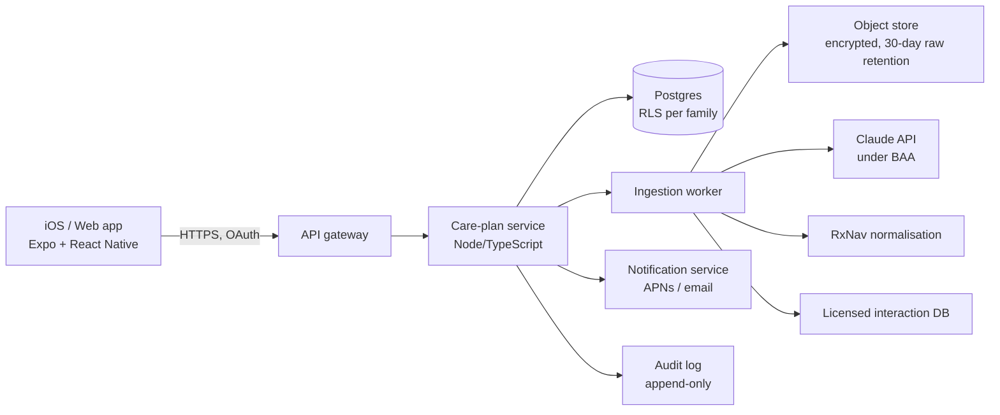

# AI Product Innovation Pipeline — Five Concepts, One Lead, Five Prototypes

**Prepared:** October 2026 · **Format:** investment memo + build specs · **Prototypes:** [`/apps`](../apps/index.html)

> **How to read the numbers.** Public figures are cited with their source and year. Anything marked *model* is a planning assumption, not a measured result. Check it against primary data before using it in a raise. Market data reflects public information up to mid-2026; re-check prices, regulations and funding rounds before external use.

---

## Executive Overview

| # | Concept | Sector | Human need | Primary buyer | Verdict |
|---|---------|--------|-----------|---------------|---------|
| 1 | **CareLoop** | Healthcare | Families coordinating care for an ageing parent after a hospital stay | Employers, health plans, then direct-to-consumer | **LEAD** |
| 2 | **PaperClear** | Fintech / productivity | Understanding and answering bills, reminders and debt-collection letters | Banks, municipalities, consumers | Strong #2 |
| 3 | **Retrofit Navigator** | Climate | Knowing which home-energy upgrade to do first, and trusting the quote | Installers (lead-gen), banks (green mortgages) | Viable, channel-dependent |
| 4 | **WorkTongue** | Education | Migrant workers needing job-specific language fast | Employers in care, construction and logistics; public skills programmes | Viable niche, strong in Nordics |
| 5 | **Rolig ReachOut** | Human connection | Loneliness, and drifting away from real relationships | Consumers, municipalities | Mission-strong, weakest economics |

**Method.** Each need was screened with a five-part validation filter. (1) **Frequency × severity**: how often it happens and how much it hurts. (2) **Current spend**: is money or time already being burned on it? (3) **Workaround evidence**: spreadsheets, Facebook groups, paid human concierges. (4) **AI leverage**: does 2025–26 model capability (vision, long-context document reading, structured outputs, speech) change the cost curve by about 10×? (5) **Distribution**: is there a buyer who already pays for this outcome?

---

# PART 1: FIVE AI-POWERED PRODUCT CONCEPTS

## Concept 1 — CareLoop: the family care-transition copilot

### Problem Statement
- **Scale.** An estimated **63 million** Americans provide unpaid care to an adult or child with special needs, up about 45% since 2015 (AARP/NAC, *Caregiving in the US 2025*). In Norway, Helsedirektoratet estimates **about 800,000** informal carers (pårørende).
- **The acute moment is discharge.** Families get a dense packet: new prescriptions, stopped medicines, follow-ups, warning signs. They must turn it into action across several siblings within 24–72 hours. Classic studies found **~19–20%** of Medicare patients readmitted within 30 days (Jencks et al., NEJM 2009). About **1 in 5** patients had an adverse event within weeks of discharge, most of them drug-related (Forster et al., Ann Intern Med 2003).
- **Cost to families.** Caregivers spend on average about **$7,200/year** out of pocket (AARP 2021). Many cut hours or leave work. Employers carry the productivity loss.
- **Current workarounds.** Group texts, photos of discharge papers, shared Google Docs, and human concierge benefits that cost too much to scale.

### Solution Overview
CareLoop turns paperwork into a **shared, living care plan**:
1. **Ingest.** Photo, PDF, patient-portal export (FHIR) or pasted text.
2. **Extract.** Medicines (new, changed, stopped), doses and schedules, appointments, red-flag symptoms and daily checks. Each item is linked to the exact source line.
3. **Coordinate.** Tasks are assigned across family members with reminders and a "who's on it" view.
4. **Ask.** Plain-language Q&A grounded only in the family's documents, with "ask your clinician" escalation when a question goes beyond what is written.
5. **Escalate.** Optional human nurse navigator, sold as a premium or employer add-on.

**AI integration:** Claude vision and PDF reading for extraction, structured outputs for a typed care-plan schema, RxNorm normalisation (NLM RxNav), and a licensed drug-interaction database for checks. The model **organises clinician instructions; it never issues new clinical recommendations.** That is the regulatory design line.

### Business Model Canvas

```
┌────────────────────┬────────────────────┬─────────────────────┬────────────────────┬────────────────────┐
│ KEY PARTNERS       │ KEY ACTIVITIES     │ VALUE PROPOSITION   │ CUSTOMER RELATIONS │ CUSTOMER SEGMENTS  │
│ • Benefits brokers │ • Document AI eval │ Families: "From     │ • Self-serve app   │ • Employers 1k+    │
│ • Medicare Adv.    │ • Clinical safety  │   discharge packet  │ • Nurse navigator  │   staff (benefit)  │
│   plans            │   review           │   to a shared plan  │   (premium)        │ • Medicare Adv. /  │
│ • Hospital transi- │ • Employer sales   │   in 10 minutes."   │ • Employer HR      │   health plans     │
│   tional-care teams│ • FHIR integrations│ Employers: lower    │   reporting        │ • Adult children   │
│ • Drug-database    │                    │   absenteeism of    ├────────────────────┤   35–64 (D2C)      │
│   licensor         ├────────────────────┤   caregiving staff  │ CHANNELS           │ • Nordic munici-   │
│ • Claude API (BAA) │ KEY RESOURCES      │ Plans/hospitals:    │ • Benefit brokers  │   palities (later) │
│                    │ • Labeled eval set │   fewer avoidable   │ • HR platforms     │                    │
│                    │ • Care-plan schema │   readmissions      │ • Caregiver SEO /  │                    │
│                    │ • Clinical advisors│                     │   communities      │                    │
├────────────────────┴────────────────────┴──────┬──────────────┴────────────────────┴────────────────────┤
│ COST STRUCTURE                                 │ REVENUE STREAMS                                         │
│ • AI inference ≈ $2 / active family / mo (model)│ • Employer: $2.00–3.00 PEPM (per eligible employee)    │
│ • Nurse navigators (premium tier)              │ • Health plan: PMPM or per-transition fee              │
│ • Enterprise sales (AE + SE)                   │ • D2C: $14.99/mo family plan; free single-document tier │
│ • Compliance (SOC 2, HIPAA)                    │ • Premium navigator: $49/mo add-on                       │
└────────────────────────────────────────────────┴────────────────────────────────────────────────────────┘
```

**Unit economics (model).**

| Metric | Employer channel | D2C channel |
|---|---|---|
| Price | $2.50 PEPM on 10,000 eligible staff = $300k ACV | $14.99/mo |
| Activation | 5% of eligible households = 500 families | n/a |
| Revenue per active family | $600/yr | $180/yr at full year |
| Variable cost per active family | ≈ $60/yr (AI $24, infra $6, navigator pool $30) | ≈ $30/yr |
| Gross margin | ~85–90% before navigator upsell | ~80% after app-store fees |
| CAC | $90–150k per enterprise logo (6–9 month cycle) | $40–60 (search, caregiver communities) |
| Payback / LTV:CAC | 4–6 months on ACV | 8%/mo churn (episodic need) → LTV ≈ $160 → ~3× |

**Market sizing (model).** About 160M employed US workers. Firms with 1,000+ staff employ roughly 50M. **SAM ≈ 50M × $2.50 × 12 ≈ $1.5B/yr** in the employer channel alone. Year-5 SOM of 1.5M covered lives ≈ **$45M ARR**, before the health-plan channel.

### Target Market & GTM Strategy
- **Beachhead:** self-insured US employers with 1,000–20,000 staff and an older or mid-career workforce (hospital systems, universities, public sector, manufacturing). They feel caregiving absenteeism and buy through brokers.
- **Wedge:** "Discharge in a box." A free family tier spreads virally inside families (each plan invites 2–4 relatives). That gives employers usage proof they can see.
- **Expansion:** Medicare Advantage plans (transitional-care incentives), then Nordic municipalities, where the 2025–2026 carer strategy (*pårørendestrategien*) creates public demand.

### Competitive Landscape

| Player | Model | Strength | Gap CareLoop exploits |
|---|---|---|---|
| Wellthy, Cariloop, Homethrive | Employer benefit, human care concierge | Trusted brands, broker relationships | Human-heavy cost; slow at the 48-hour discharge moment |
| ianacare, CaringBridge, Lotsa Helping Hands | Free or low-cost coordination | Network effects among friends and family | No document intelligence; manual entry |
| Medisafe and pill reminder apps | Medication adherence | Strong reminder UX | Single patient, no family, no discharge parsing |
| Patient portals (Epic MyChart etc.) | Provider-tethered | Source of truth | Siloed per health system; poor for families and proxies |
| General chatbots | Horizontal | Free, capable | No shared plan, no tasks, no provenance, no compliance |

**Differentiation:** the only product that combines (a) document-grade extraction with provenance, (b) a multi-person task graph, and (c) employer reporting, at software cost.

### Technical Feasibility & MVP Architecture
- **Feasible today:** multimodal document reading, structured outputs against JSON schemas, and long context for a full hospital packet are production-grade in 2025–26 frontier models.
- **MVP stack:** Expo (React Native) app → Node/TypeScript API on AWS (HIPAA-eligible services) → Postgres (row-level security per family) → Claude API under a BAA → RxNav normalisation → licensed interaction database (First Databank or DrugBank; NLM retired its free interaction API in January 2024).
- **Hard parts:** (1) handwritten or low-quality scans, handled with a confidence score and "please confirm" UI; (2) liability, handled by keeping it to transcription and coordination with a clinician-review loop; (3) enterprise security reviews, handled with SOC 2 Type I by month 6.
- **MVP timeline:** 12 weeks to a closed beta (see Part 3).

---

## Concept 2 — PaperClear: AI for household paperwork and debt letters

### Problem Statement
- Financial letters are dense, legalistic and frightening. People in financial stress often **stop opening mail**. Deadlines pass, fees stack, and a manageable bill turns into a collection case or enforcement.
- Debt collection is consistently one of the largest complaint categories at the US CFPB. In 2022 the Urban Institute found **roughly a quarter** of US adults with a credit record had debt in collections. In Norway, collection fees by stage are capped by regulation (inkassoforskriften), so early action changes the outcome in money terms.
- Free public help exists but is overloaded: NAV økonomirådgivning in Norway, and non-profit credit counselling in the US.

### Solution Overview
Photo of a letter → in 20 seconds the user gets:
- **Classification:** invoice, reminder, collection warning, collection demand, court or enforcement, tax.
- **Extracted facts:** amount breakdown, deadline, creditor, legitimacy checks (is the sender registered, are the fees within the legal maximum).
- **Next step:** a drafted reply in the letter's language (payment plan, dispute, documentation request) plus a deadline tracker.
- **Escalation:** handoff to human debt advisers, with a ready case summary.

### Business Model Canvas

```
┌──────────────────┬──────────────────┬───────────────────┬──────────────────┬──────────────────┐
│ KEY PARTNERS     │ KEY ACTIVITIES   │ VALUE PROP        │ RELATIONSHIPS    │ SEGMENTS         │
│ • Banks (hardship│ • Letter-type    │ Consumer: "Open   │ • App + reminders│ • Consumers in   │
│   & collections) │   eval sets per  │   the letter with │ • Adviser handoff│   financial      │
│ • Municipal debt │   country        │   us. Know what,  │                  │   stress         │
│   advice (NAV)   │ • Fee-rule engine│   how much, when."│ CHANNELS         │ • Banks (early-  │
│ • Credit unions  │ • B2B integration│ Bank: fewer write-│ • Bank app white-│   arrears)       │
│                  │ KEY RESOURCES    │   offs, earlier   │   label          │ • Municipalities │
│                  │ • Country rule   │   arrangements    │ • Social services│ • Employers (fin.│
│                  │   packs          │ Advisers: cases   │ • SEO "inkasso-  │   wellbeing)     │
│                  │                  │   arrive triaged  │   varsel hjelp"  │                  │
├──────────────────┴──────────────────┴─────┬─────────────┴──────────────────┴──────────────────┤
│ COSTS: inference ≈ $0.05/letter (model);  │ REVENUE: bank white-label $0.50–1.50 per active   │
│ legal review of rule packs; B2B sales     │ customer/mo; municipal licence; consumer freemium │
│                                           │ $5.99/mo (unlimited letters + tracker)           │
└───────────────────────────────────────────┴──────────────────────────────────────────────────┘
```

**Unit economics (model):** a mid-size Nordic bank with 40,000 customers in early arrears at $1/customer/month → ~$480k ACV. Value to the bank: even a 2–3 pp improvement in "cure rate" on early arrears is worth multiples of that. Consumer tier at 5% conversion, $5.99/mo, 6%/mo churn → LTV ≈ $85 against a CAC of ~$15 via SEO and content.

### Target Market & GTM Strategy
- **Phase 1 (Norway):** consumer app, SEO-led ("inkassovarsel", "betalingsoppfordring", "hva betyr…"), with free-text Norwegian and English support.
- **Phase 2:** white-label for savings banks' hardship teams, plus pilot municipalities.
- **Phase 3:** Nordics, UK and Germany via rule packs. Each country is a fee and process configuration, not a rebuild.

### Competitive Landscape

| Player | Gap |
|---|---|
| Rocket Money, Trim (US) | Bill negotiation and subscription cancelling; no letter understanding or collection workflow |
| DoNotPay | "Robot lawyer" positioning drew an FTC order in 2025. A cautionary tale: PaperClear explains and drafts, it does not claim to be legal counsel |
| Bank apps | See their own debts only, not third-party collectors |
| Public debt advice | Human, free, capacity-constrained. **A partner, not a competitor** |

### Technical Feasibility & MVP Architecture
Vision extraction → typed schema → deterministic **fee-rule engine** per country (code, not LLM) → LLM-drafted reply → user edits and sends. MVP in 8 weeks. Main risk: incorrect legal statements. Mitigation: rights text comes from a reviewed library, and the LLM only selects and adapts it.

---

## Concept 3 — Retrofit Navigator: the independent home-energy adviser

### Problem Statement
- Buildings account for about **40% of EU energy consumption** and ~36% of energy-related emissions (European Commission). The recast **Energy Performance of Buildings Directive (2024)** requires member states to cut average residential primary energy use by **16% by 2030** and **20–22% by 2035**, with transposition due in 2026.
- Homeowners face three failures: they do not know what to do first, they cannot compare quotes, and they cannot work out the grants. In the US the federal homeowner credits (25C/25D) **ended for property placed in service after 31 December 2025**. That shifts US demand to state and utility programmes and makes payback clarity matter even more.
- Installer leads are expensive and low quality. Homeowners distrust "free surveys" from sellers.

### Solution Overview
Address + a few answers + optional utility data or a photo of the electricity bill → **ranked upgrade plan by payback**, with CO₂, grant eligibility and an installer-ready brief. Then a **quote-comparison** step: upload two or three quotes and AI normalises scope (sizing, warranty, exclusions) side by side.

### Business Model Canvas

```
┌──────────────────┬──────────────────┬───────────────────┬──────────────────┬──────────────────┐
│ KEY PARTNERS     │ KEY ACTIVITIES   │ VALUE PROP        │ RELATIONSHIPS    │ SEGMENTS         │
│ • Vetted install-│ • Building-physics│ Homeowner: "An   │ • Self-serve     │ • Owner-occupiers│
│   ers            │   model & data   │   adviser who     │ • Quote review   │   of pre-1990    │
│ • Banks (green   │ • Quote parsing  │   sells nothing." │                  │   houses         │
│   mortgages)     │ • Installer QA   │ Installer: pre-   │ CHANNELS         │ • Installers     │
│ • Utilities/DSOs │ KEY RESOURCES    │   qualified jobs  │ • Bank apps      │ • Banks          │
│ • Grant agencies │ • Cost & savings │ Bank: green-loan  │ • Utility portals│ • Utilities      │
│                  │   dataset        │   origination     │ • SEO            │                  │
├──────────────────┴──────────────────┴─────┬─────────────┴──────────────────┴──────────────────┤
│ COSTS: data acquisition, installer vetting,│ REVENUE: success fee 4–6% of signed job (or €150– │
│ inference (~€0.10/plan)                    │ 300 per qualified lead); bank referral fees;     │
│                                            │ utility white-label licence                       │
└────────────────────────────────────────────┴──────────────────────────────────────────────────┘
```

**Unit economics (model):** an average signed job of €8,000 (air-to-water heat pump or insulation bundle) × 5% = €400 per conversion. At 3% plan-to-signed-job conversion and €12 CAC per completed plan, the cost per signed job is €400, which only breaks even on CAC. Profitability depends on **channel partners with near-zero CAC** (banks, utilities). That is the central GTM bet.

### Target Market & GTM Strategy
Launch in Norway and Sweden through one savings bank's green-mortgage flow and one regional utility. Expand to Germany and the Netherlands as EPBD renovation pressure peaks. Avoid D2C paid acquisition until conversion data is proven.

### Competitive Landscape

| Player | Gap |
|---|---|
| Otovo, Octopus Energy, Aira and other heat-pump or solar sellers | Product-biased; one technology |
| Public calculators (Enova, national EPC tools) | Generic, no quote comparison, no installer handoff |
| US: Rewiring America (non-profit), Sealed, Quilt, Elephant Energy | US-focused; mostly sell their own install |
| Energy auditors | Credible but €300–800 and slow |

**Differentiation:** brand-neutral, payback-ranked, **quote normalisation** (the moment of highest anxiety), and grant-rule awareness.

### Technical Feasibility & MVP Architecture
Deterministic building-energy model (degree-days × U-values × area, calibrated to metered use) + LLM for document understanding (bills, quotes) and the narrative plan. **The numbers come from code; the LLM explains them.** MVP 10 weeks. Data risk: regional cost tables need installer input. Mitigation: seed with 30 installer price lists.

---

## Concept 4 — WorkTongue: job-specific language coaching

### Problem Statement
- WHO projects a global shortfall of about **11 million health workers by 2030**. Nordic elder care, construction and logistics depend more and more on migrant workers. About **one in five** residents of Norway is an immigrant or Norwegian-born to immigrant parents (SSB).
- Licensing requirements set a hard bar. Health personnel trained outside the EU/EEA must document Norwegian at **B2** for authorisation (Helsedirektoratet). Communication errors in care settings are a patient-safety issue.
- General apps (Duolingo, Babbel) teach tourist and everyday language. Classroom courses are slow and off-shift. Workers need **"what to say to a resident in pain at 07:00"**.

### Solution Overview
Role-play scenarios built per job and per workplace: a resident, a nurse, a foreman, a customer. Speech in, speech out. AI plays the counterpart, judges **"would a colleague understand you?"** (communicative success over grammar perfection), gives at most two corrections, and builds a job-specific vocabulary deck. Employers upload their own routines (e.g. the shift handover template) to generate custom scenarios.

### Business Model Canvas

```
┌──────────────────┬──────────────────┬───────────────────┬──────────────────┬──────────────────┐
│ KEY PARTNERS     │ KEY ACTIVITIES   │ VALUE PROP        │ RELATIONSHIPS    │ SEGMENTS         │
│ • Municipal care │ • Scenario design│ Worker: "Practise │ • Daily 5-min    │ • Municipal &    │
│   employers      │   with domain    │   tomorrow's shift│   streaks        │   private care   │
│ • Staffing agen- │   experts        │   today."         │ • Supervisor     │ • Construction   │
│   cies           │ • Speech evals   │ Employer: faster  │   dashboard      │   contractors    │
│ • Public skills  │ KEY RESOURCES    │   onboarding,     │ CHANNELS         │ • Staffing agen- │
│   funding (HK-dir│ • Scenario       │   safer care,     │ • Direct B2B     │   cies           │
│   Kompetanse-    │   library        │   funding-eligible│ • Staffing agen- │ • Individuals    │
│   programmet)    │                  │                   │   cies           │   (B2 prep)      │
├──────────────────┴──────────────────┴─────┬─────────────┴──────────────────┴──────────────────┤
│ COSTS: speech + LLM ≈ $1.50/active learner/│ REVENUE: employer seat NOK 199/mo (~$19);         │
│ mo (model); scenario authoring; B2B sales  │ custom scenario packs; consumer B2 prep NOK 149/mo│
└────────────────────────────────────────────┴──────────────────────────────────────────────────┘
```

**Unit economics (model):** a municipality with 300 migrant care workers × NOK 199 × 12 ≈ NOK 716k/yr (~$68k) per contract. Gross margin ~90%. Public workplace-skills grants (Kompetanseprogrammet) can fund much of the cost. That shortens the sales cycle.

### Target Market & GTM Strategy
Start with 3 Norwegian municipalities' elder-care services plus one staffing agency. Prove time-to-independent-shift and supervisor-rated communication scores. Expand to Swedish and Danish care sectors, then German *Pflege* (similar shortages, B1/B2 requirements).

### Competitive Landscape

| Player | Gap |
|---|---|
| Duolingo, Babbel (incl. Babbel for Business) | General curriculum; no workplace role-play depth in Norwegian |
| Speak, Praktika and other AI speaking apps | English-first; consumer; not job-specific |
| Adult education centres, *Norsk på arbeidsplassen* courses | Human, scheduled, slow; WorkTongue complements them |

### Technical Feasibility & MVP Architecture
On-device or browser speech recognition (Whisper-class models or platform ASR, `nb-NO`), LLM role-play with structured feedback, TTS for model answers. MVP 8 weeks. Risk: ASR accuracy with strong accents. Mitigation: judge by meaning, allow typed fallback, and evaluate on accented speech samples.

---

## Concept 5 — Rolig ReachOut: AI that pushes you back toward people

### Problem Statement
- The WHO Commission on Social Connection (2025) reports that **about 1 in 6 people** worldwide experience loneliness. It links loneliness to an estimated **871,000 deaths per year**. The US Surgeon General's 2023 advisory framed social disconnection as a public-health threat.
- The market's answer so far, **AI companions**, now faces real regulatory backlash. In 2025: Illinois restricted AI-delivered therapy, California passed companion-chatbot safeguards (SB 243), and the FTC opened a 6(b) inquiry into AI companions. Consumer AI-therapy pioneer Woebot shut down its app in mid-2025.
- The unmet need is not a better artificial friend. It is **lowering the activation energy to contact a real one** when you are depleted.

### Solution Overview
A local-first wellbeing app (extending the existing *Rolig Pusterom* app in this repo) with three loops:
1. **Check-in → breathe → small step** (existing app).
2. **ReachOut:** a short list of real people, "days since contact", and an energy-aware message writer (one line / short message / suggest meeting). The user sends it from their own messenger. The app never messages anyone.
3. **Connection garden:** gentle weekly reflection, no streak shaming.

Privacy principle: **everything stays on device by default**. AI is opt-in and sends only the minimum (first name, relationship, the user's note).

### Business Model Canvas

```
┌──────────────────┬──────────────────┬───────────────────┬──────────────────┬──────────────────┐
│ KEY PARTNERS     │ KEY ACTIVITIES   │ VALUE PROP        │ RELATIONSHIPS    │ SEGMENTS         │
│ • Municipalities │ • Behavioural    │ "The smallest     │ • Calm, no-push  │ • Adults 20–40 in│
│   (public-health │   design         │   possible step   │   notifications  │   transitions    │
│   programmes)    │ • Privacy        │   back to people."│ • Optional group │   (moves, study) │
│ • Student welfare│   engineering    │ No AI friend. No  │   meetups (B2B)  │ • Seniors (via   │
│   orgs           │ KEY RESOURCES    │   data harvesting.│ CHANNELS         │   municipalities)│
│ • Employers (EAP)│ • Trust / brand  │                   │ • App stores     │ • Students       │
│                  │                  │                   │ • Student orgs   │                  │
├──────────────────┴──────────────────┴─────┬─────────────┴──────────────────┴──────────────────┤
│ COSTS: small team, near-zero infra (local-│ REVENUE: freemium NOK 39/mo; municipal/student-   │
│ first), opt-in inference ≈ $0.002/message │ welfare licences; employer EAP add-on             │
└───────────────────────────────────────────┴──────────────────────────────────────────────────┘
```

**Unit economics (model):** consumer wellbeing apps typically convert 2–5% to paid with high churn. LTV ≈ NOK 200–300. Paid acquisition does not work, so growth must be organic and institutional. **Honest assessment:** strong mission and differentiation, venture-scale economics unproven. Best run as a capital-light product or a B2G programme.

### Target Market & GTM Strategy
Norwegian student welfare organisations and municipal public-health programmes first (free to the end user, licence-funded). Organic growth through word of mouth. Position explicitly as "not therapy, not a companion".

### Competitive Landscape

| Player | Gap |
|---|---|
| Replika, Character.ai | Substitutes for human contact; regulatory and reputational headwinds |
| Calm, Headspace | Inward-focused (meditation); no relational action |
| Timeleft, Meetup, Bumble BFF | Strangers; high activation energy for depleted users |
| Contact-reminder CRMs (Dex, Clay) | Built for networking, not wellbeing |

### Technical Feasibility & MVP Architecture
Already ~70% built as a static, local-first web app (`index.html` + `apps/reachout.html`). Next: PWA install, encrypted local backup, optional server-side AI proxy so no API key lives on the device. MVP 4 weeks.

---

# PART 2: PROTOTYPE SPECIFICATIONS

All five have working web prototypes in [`/apps`](../apps/). They run offline in demo mode, and Claude is optional with the user's own API key. The wireframes below describe the production iOS/web layout. ASCII wireframes are at 375 pt width.

## 2.1 CareLoop

**User flow:** Onboard (who are you caring for) → Import (camera / PDF / portal) → Review extraction (confirm low-confidence items) → Plan (meds, warning signs, appointments) → Invite family → Tasks → Ask.

```
┌─────────────────────────────┐   ┌─────────────────────────────┐   ┌─────────────────────────────┐
│ ◀ Mum · Ingrid, 81          │   │ Medicines            ⓘ src  │   │ Tasks         [+ Add]       │
│ ┌─────────────────────────┐ │   │ Furosemide 40 mg  [NEW]     │   │ ☐ Book GP blood test        │
│ │  📷 Scan papers         │ │   │  1× morning                 │   │    Anna · within 7 days     │
│ └─────────────────────────┘ │   │ Metoprolol 25 mg            │   │ ☐ Pharmacy pickup           │
│ ┌──────────┐ ┌────────────┐ │   │  2× daily                   │   │    Jonas · today            │
│ │ 📄 PDF   │ │ 🏥 Portal  │ │   │ Ibuprofen       [STOPPED]   │   │ ☑ Remove ibuprofen from     │
│ └──────────┘ └────────────┘ │   │  kidney + bleeding risk     │   │   pill box · Anna           │
│                             │   │ ─────────────────────────── │   │ ─────────────────────────── │
│ Recent: Discharge 19.10 ✓   │   │ ⚠ Get help now if…          │   │ 💬 Ask about Mum's papers   │
│                             │   │ chest pain · fainting       │   │ ┌─────────────────────────┐ │
│ [Plan] [Tasks] [Ask] [Fam]  │   │ [Plan] [Tasks] [Ask] [Fam]  │   │ └─────────────────────────┘ │
└─────────────────────────────┘   └─────────────────────────────┘   └─────────────────────────────┘
```

**Core features & AI capabilities:** multimodal extraction with per-field source highlight; medicine reconciliation against the previous list (new/changed/stopped); interaction flags from a licensed database; grounded Q&A (answers only from the family's documents, with citations); task auto-assignment; daily-check logging (weight, BP) with threshold alerts written by clinicians.

**KPIs:** time from scan to shared plan < 10 min (median); extraction field accuracy ≥ 97% on the eval set; **zero** invented doses; ≥ 2.5 family members per plan; 30-day retention ≥ 45% during an active care episode; employer activation ≥ 5% of eligible staff in year 1.

**90-day roadmap:** see Part 3 (lead concept).

## 2.2 PaperClear

**User flow:** Snap letter → "What this is" card (type, urgency, amount, deadline) → Check legitimacy → Choose goal (plan / dispute / documentation / pay) → Edit reply → Send yourself → Deadline tracker.

```
┌─────────────────────────────┐   ┌─────────────────────────────┐
│ [MEDIUM] Debt-collection    │   │ Reply · payment plan        │
│ warning                     │   │ ┌─────────────────────────┐ │
│ kr 1 905,40                 │   │ │ Hei, jeg viser til…     │ │
│ Deadline 06.11 · Telefon AS │   │ │ …[beløp] kr per måned   │ │
│ ─────────────────────────── │   │ └─────────────────────────┘ │
│ Principal       kr 1 849,00 │   │ [Copy] [Email] [Edit]       │
│ Reminder fee        kr 35,00│   │ ─────────────────────────── │
│ Interest            kr 21,40│   │ 📅 Deadlines                │
│ ✓ Sender registered         │   │ 06.11 Telefon AS  kr 1 905  │
│ ✓ Fees within legal maximum │   │ 15.11 Skatteetaten  kr 4 210│
│ [Ask for a payment plan ▸]  │   │ [Talk to a debt adviser ▸]  │
└─────────────────────────────┘   └─────────────────────────────┘
```

**AI capabilities:** letter classification; amount and deadline extraction; fee-legality check (rule engine); reply drafting in the letter's language; triage summary for human advisers.
**KPIs:** extraction accuracy ≥ 98% on amounts and dates; ≥ 60% of users take an action within 48 h; adviser handoff time saved ≥ 20 min per case; bank pilot cure-rate uplift ≥ 2 pp.
**90-day roadmap:** W1–4 Norwegian letter corpus (200 de-identified samples) + rule engine; W5–8 consumer beta, SEO content; W9–12 one bank and one municipality pilot, adviser handoff.

## 2.3 Retrofit Navigator

**User flow:** Address → house basics (year, area, heating) → optional bill photo → ranked plan → grant check → "Get quotes" → upload quotes → side-by-side comparison → sign.

```
┌─────────────────────────────┐   ┌─────────────────────────────┐
│ 25 200 kWh/yr  ≈ 31 500 NOK │   │ Compare quotes              │
│ ─────────────────────────── │   │           A       B      C  │
│ 1 Hot-water timer   2.0 yrs │   │ Price   148k   162k   139k  │
│ 2 Thermostats       3.0 yrs │   │ kW       8      10      7 ⚠ │
│ 3 Air-to-air HP     4.5 yrs │   │ SCOP    4.1    4.4    3.6   │
│ 4 Draught-proofing  4.6 yrs │   │ Warranty 5y     7y     2y ⚠ │
│ 5 Attic insulation  7.9 yrs │   │ Removal  ✓      ✓      ✗ ⚠ │
│ ─────────────────────────── │   │ ─────────────────────────── │
│ Grant check: 2 of 5 eligible│   │ "C is cheapest but under-   │
│ [Get 3 vetted quotes ▸]     │   │  sized for 140 m² at -15°C" │
└─────────────────────────────┘   └─────────────────────────────┘
```

**AI capabilities:** bill and quote parsing; scope normalisation; sizing sanity checks against the deterministic model; plain-language plan.
**KPIs:** plan completion ≥ 55%; quote-upload rate ≥ 20%; plan→signed job ≥ 3%; installer NPS ≥ 40; modelled vs metered savings error < 20% at 12 months.
**90-day roadmap:** W1–4 Norwegian cost tables + calibration on 50 homes with metered data; W5–8 bank-embedded beta; W9–12 quote comparison + 10 vetted installers in one region.

## 2.4 WorkTongue

**User flow:** Pick job + level → daily scenario (counterpart speaks) → answer by voice → feedback (understood? / one fix / say it like this) → continue the 3–4 turn conversation → vocabulary review. Supervisor dashboard (B2B).

```
┌─────────────────────────────┐   ┌─────────────────────────────┐
│ Care · B1 · Day 12 🔥       │   │ ✓ A colleague would         │
│ [Resident]                  │   │   understand you  ★★★★☆     │
│ "Jeg har så vondt i magen   │   │ Fix: "hvor lenge HAR du     │
│  i dag."              🔊    │   │   hatt det" (word order)    │
│ Hint: ask where, how long,  │   │ Say it like this:           │
│ tell the nurse              │   │ "Så leit. Hvor gjør det     │
│ ┌─────────────────────────┐ │   │  vondt?…"             🔊    │
│ │       🎤  Hold to talk  │ │   │ New: sykepleier · si fra    │
│ └─────────────────────────┘ │   │ [Continue ▸]                │
└─────────────────────────────┘   └─────────────────────────────┘
```

**AI capabilities:** ASR (`nb-NO`), role-play LLM with communicative-success scoring, targeted correction, TTS, employer-document → scenario generation.
**KPIs:** weekly active learners ≥ 60% of seats; avg 4+ sessions/week; supervisor-rated communication +1 level in 12 weeks; B2 pass-rate uplift vs control; seat renewal ≥ 85%.
**90-day roadmap:** W1–4 60 care scenarios with two municipal nurses; W5–8 pilot with 40 workers; W9–12 supervisor dashboard + construction pack + funding-application template for employers.

## 2.5 Rolig ReachOut

**User flow:** Home check-in → (low mood) → breathe → small step suggestion "send one message" → choose person → energy level → message → "I sent it" → weekly garden.

```
┌─────────────────────────────┐   ┌─────────────────────────────┐
│ This week: 2 messages 🌱    │   │ Message to Ola              │
│ ─────────────────────────── │   │ Energy: ● low ○ some ○ high │
│ Ola     friend   41 days ▸  │   │ ┌─────────────────────────┐ │
│ Mari    family   12 days ▸  │   │ │ Tenkte på deg, Ola.     │ │
│ Per     ex-colleague never ▸│   │ │ Ingen grunn, bare hei.  │ │
│ [+ Add someone you miss]    │   │ └─────────────────────────┘ │
│                             │   │ [Copy]       [I sent it ✓]  │
│ 🫁 Pusterom · 📝 Innsjekk   │   │ Not therapy · 116 123       │
└─────────────────────────────┘   └─────────────────────────────┘
```

**AI capabilities:** energy-aware message drafting (opt-in), on-device by default.
**KPIs:** ≥ 1 real message sent per active user per week; self-reported "closer to someone" +15% at 8 weeks; zero personal data server-side by default; D30 retention ≥ 25%.
**90-day roadmap:** W1–4 PWA + iOS home screen + encrypted export; W5–8 server AI proxy (no client key), student-org pilot; W9–12 municipality pilot with seniors (larger text, voice input).

---

# PART 3: FINAL RECOMMENDATION

## SELECTED CONCEPT: **CareLoop**

### Scoring matrix (1–5, weighted)

| Criterion (weight) | CareLoop | PaperClear | Retrofit | WorkTongue | ReachOut |
|---|---|---|---|---|---|
| Market size (25%) | **5** | 4 | 4 | 3 | 3 |
| Willingness to pay / budget owner (20%) | **5** | 4 | 3 | 4 | 2 |
| AI leverage vs status quo (20%) | **5** | 5 | 3 | 4 | 3 |
| Defensibility (15%) | **4** | 3 | 3 | 3 | 2 |
| Regulatory / liability risk, inverted (10%) | 3 | 3 | **4** | **4** | 3 |
| Time to MVP (10%) | 3 | 4 | 3 | 4 | **5** |
| **Weighted score** | **4.45** | 3.95 | 3.35 | 3.60 | 2.85 |

### Executive Summary (300 words)

Every year, millions of families get the same dense discharge packet after a parent's hospital stay. New pills, stopped pills, follow-ups, warning signs. They have 48 hours to turn it into action across siblings who live in different cities. The cost of getting it wrong is high: about one in five older patients is readmitted within a month, and post-discharge adverse events are mostly medication-related. In the US, 63 million unpaid caregivers absorb this work, and their employers absorb the lost productivity.

**CareLoop** is an AI care-transition copilot. A family member photographs the paperwork. In minutes CareLoop produces a shared, source-linked care plan: a reconciled medication list, appointments, red-flag symptoms, daily checks, and tasks assigned across the family. A grounded Q&A answers only from the family's own documents and sends clinical questions back to clinicians. CareLoop organises what clinicians wrote; it does not practise medicine.

The timing is right because frontier models now read messy multi-page documents with production-grade accuracy at a few cents per document. That collapses the cost of what human care concierges do today at $100+ per case. CareLoop sells first to **self-insured employers** as a caregiving benefit at $2–3 PEPM. Family-plan virality gives proof of usage, and **health plans** follow as a second channel with readmission economics.

Defensibility compounds through (1) a labelled evaluation corpus of real discharge documents and correction signals, (2) the multi-person family graph, which is costly to rebuild elsewhere, and (3) enterprise security and compliance assets (BAA, SOC 2, HIPAA processes).

The ask: **$3.5M seed** for 18 months of runway. It funds a 9-person team, a 12-week MVP, three employer pilots by month 6, and $1M ARR in contracted pipeline by month 15. Success gates: ≥ 97% extraction accuracy, zero fabricated doses, and ≥ 5% employer activation.

### Why This Solution Wins

**Market size.** Employer SAM ≈ $1.5B/yr in the US alone (model, above). Health-plan and Nordic municipal channels come on top. Caregiving demand grows mechanically with demographics: the US 65+ population roughly doubles between 2000 and 2030.

**Defensibility.**
1. *Data flywheel:* every user confirmation or correction on an extracted field becomes labelled training and eval data. Generic chatbots never see it.
2. *Graph lock-in:* plans hold 2–5 family members plus history, and switching means re-onboarding a whole family mid-crisis.
3. *Compliance moat:* BAAs, SOC 2, HIPAA processes and clinical-safety documentation take 9–12 months for followers.
4. *Distribution moat:* broker relationships and benefits-platform integrations.

**Timing.**
- Model capability: document vision plus structured outputs became reliable and cheap in 2025–26.
- Interoperability: CMS patient-access APIs and SMART on FHIR make portal imports possible.
- Buyer pull: caregiving benefits moved from niche to standard RFP items in large-employer benefits after 2020.
- Labour: human concierge models hit margin ceilings, so AI-first entrants win on price.

**Key risks and mitigations.**

| Risk | Mitigation |
|---|---|
| Clinical liability from extraction errors | Source-linked fields, confidence UI, mandatory confirmation of medicines, no new recommendations, clinical advisory board, malpractice/E&O cover |
| FDA device classification | Stay within transcription and coordination; regulatory counsel review of every feature against FDA's Clinical Decision Support guidance |
| Long enterprise sales cycles | D2C family tier for proof; brokers; start with mid-size self-insured employers |
| Incumbent concierge benefits add AI | Speed + price; offer white-label "AI layer" to concierges as a second channel |

### Technical Specification Document

````markdown
# CareLoop — Technical Specification v0.1

## 1. Overview
CareLoop converts care-transition documents (discharge summaries, medication lists,
after-visit notes) into a structured, shared family care plan with tasks and grounded Q&A.

## 2. Goals / Non-goals
Goals
- G1  Extract medications, appointments, red flags and daily checks with per-field provenance.
- G2  Reconcile against the previous medication list (new / changed / stopped / continued).
- G3  Multi-member family workspace with tasks, reminders and roles.
- G4  Grounded Q&A over the family's documents only, with citations.
Non-goals
- No diagnosis, dosing advice or treatment recommendations.
- No direct messaging to clinicians in v1 (export/print only).

## 3. Architecture


## 4. Ingestion & AI pipeline
1. **Classify** document type (discharge, med list, lab, other).
2. **Extract** → `CarePlanDraft` via structured outputs (JSON Schema, strict).
   Model: Claude Opus 5.5, effort `medium`. Evaluate Sonnet 5.5 / Haiku 5.5 per route
   against the eval set before downgrading any route for cost.
3. **Ground**: every field carries `source_span` (page, bbox or char range).
   Fields without a span are rejected.
4. **Normalise** drug names → RxCUI (RxNav). Unmatched → "please confirm" UI.
5. **Verify**: a second-pass verifier prompt re-reads the source and marks each field
   `supported | unsupported | ambiguous`. Unsupported fields are dropped; ambiguous ones
   need user confirmation.
6. **Reconcile** with the previous active list (deterministic diff on RxCUI + dose).
7. **Interaction check** (licensed DB, deterministic). The LLM only explains the flag.
8. **Plan & tasks** generated from the confirmed plan (deterministic templates + LLM wording).

Refusal and fallback handling: check `stop_reason` before parsing; server-side fallbacks
enabled; on failure, route the document to manual entry, never to a guess.

## 5. Data model (core)
- `family(id, name, region)`
- `member(id, family_id, role[owner|caregiver|viewer], user_id)`
- `care_recipient(id, family_id, display_name, birth_year)`
- `document(id, family_id, type, storage_key, uploaded_by, created_at)`
- `medication(id, recipient_id, rxcui, name, dose, schedule, status, source_doc_id, source_span, confirmed_by)`
- `appointment(id, recipient_id, what, when_text, due_date, source_span)`
- `red_flag(id, recipient_id, text, source_span)`
- `task(id, family_id, title, owner_member_id, due_date, done_at, origin[ai|user])`
- `audit_event(id, actor, action, entity, entity_id, at)`

## 6. API (v1, REST)
| Method | Path | Purpose |
|---|---|---|
| POST | /families | Create family workspace |
| POST | /families/{id}/documents | Upload; returns ingestion job id |
| GET  | /jobs/{id} | Ingestion status + draft |
| POST | /recipients/{id}/plan/confirm | Confirm reviewed draft |
| GET  | /recipients/{id}/plan | Current plan |
| CRUD | /families/{id}/tasks | Tasks |
| POST | /recipients/{id}/ask | Grounded Q&A (answers + citations) |

## 7. Security & compliance
- HIPAA: BAA with every subprocessor that touches PHI, including the model provider.
- Encryption: TLS 1.2+; AES-256 at rest; per-family data keys.
- Access: Postgres row-level security by family; least-privilege service roles.
- Retention: raw images deleted after 30 days unless the user pins them.
- Audit: append-only log for every PHI read/write.
- SOC 2 Type I by month 6, Type II by month 15.

## 8. Evaluation
- Golden set: 300 de-identified discharge documents (mixed quality, 3 health systems),
  dual-annotated by nurses.
- Release gates: field-level F1 ≥ 0.97 (meds), dose exact-match ≥ 0.99 on confirmed
  fields, **0 fabricated doses**, red-flag recall ≥ 0.95.
- Regression suite runs on every prompt or model change; results stored per version.

## 9. Observability
Per-route latency, cost per document, verifier rejection rate, user-correction rate per field.

## 10. Open questions
- Portal import priority: Epic (MyChart) vs Apple Health Records first?
- Nordic expansion: Helsenorge integration feasibility.
````

### Go-to-Market Strategy with Milestones

| Phase | Months | Focus | Milestones / exit criteria |
|---|---|---|---|
| **0. Build** | 0–3 | MVP, eval set, BAA, clinical advisers | Eval gates met; 50 beta families; median time-to-plan < 10 min |
| **1. Prove** | 4–6 | 3 employer pilots (1–5k staff each), D2C free tier | ≥ 5% activation; ≥ 2.5 members/plan; 3 case studies; SOC 2 Type I |
| **2. Sell** | 7–12 | Broker partnerships (2), first paid contracts | 8 paying employers; $600k ARR; NRR signals; first health-plan pilot |
| **3. Scale** | 13–18 | Health-plan channel; benefits marketplace listings | $1.5M ARR; Series A metrics: < 12-month CAC payback, > 80% GM |

**Acquisition.** Broker channel (benefit consultants run caregiving RFPs). Direct outbound to HR in health systems and universities. D2C SEO on high-intent caregiver queries ("what to do after a parent's hospital discharge"). Caregiver communities and hospital social-work referrals.
**Retention.** Episodic by nature, so design for re-activation: the plan stays live, and new documents restart engagement. The employer KPI is utilisation across episodes, not daily use.

### 90-Day Launch Plan

| Week | Product & AI | Go-to-market | Compliance & ops |
|---|---|---|---|
| 1–2 | Care-plan schema v1; ingest prototype (this repo's `apps/careloop.html` → TypeScript service) | 30 caregiver interviews; 10 HR leader calls | Entity, BAA requests, privacy counsel |
| 3–4 | Eval set v0 (100 docs) + annotation guide; verifier pass | Design partner LOIs (target 3 employers) | Security policies, risk register |
| 5–6 | Expo app: scan → review → plan; family invites | Landing page + waitlist; broker intro meetings | HIPAA training, vendor reviews |
| 7–8 | Tasks, reminders, grounded Q&A with citations | Content: 10 SEO guides | Pen test scoping |
| 9–10 | RxNav + interaction DB; eval set to 300; release gates in CI | Closed beta with 50 families (2 employers' staff) | SOC 2 readiness tooling |
| 11–12 | Fix top-10 correction causes; employer utilisation dashboard | Pilot kick-offs; pricing test ($2 vs $3 PEPM) | Incident runbook; DPIA for Nordic pilot |
| **Day 90 gate** | Eval gates green | 3 signed pilots, 50 active families | No open high-severity security findings |

**Team (seed):** CEO/GTM, CTO, 3 engineers (mobile, backend, ML/evals), clinical lead (RN, 0.5 FTE → 1), designer, enterprise AE (month 4), compliance/security (fractional).
**Budget split (18 months, $3.5M):** people 72%, compliance and security 8%, inference and infra 5%, GTM 12%, contingency 3%.

---

# PART 4: FIVE VIBECODE iOS/WEB APPLICATIONS

**Working web prototypes ship in this repo** (`apps/*.html`, open `apps/index.html`). Each one runs offline in demo mode with rule-based logic. With the user's own Anthropic API key it calls Claude for the AI features (structured JSON outputs, vision for photos and PDFs). For iOS, each app has a **VibeCode build prompt**: paste it into the Vibecode app to generate an Expo/React Native app, then wire it to the shared backend pattern below.

**Shared production pattern (all five):**
- Client: Expo (React Native) + TypeScript; SecureStore for tokens; local SQLite for offline-first data.
- Backend: thin server proxy (e.g. Supabase Edge Functions or a Node service) that holds the Anthropic API key. **Never ship a model key inside an app binary.** The web prototypes take a user-supplied key for demo purposes only.
- AI: Claude API (`claude-opus-5-5` default) with structured outputs (`output_config.format`) and server-side refusal fallbacks enabled; deterministic code for anything numeric or legal.
- Analytics: privacy-preserving event counts only. No document content leaves the processing path.

## App 1 — CareLoop
- **Core problem solved:** families cannot turn hospital discharge paperwork into coordinated action.
- **User journey:** scan papers → confirm extracted medicines → see warning signs and appointments → invite siblings → tasks auto-assigned → check off together.
- **Key features:** photo/PDF ingestion; new/changed/stopped medicine badges; red-flag card; shared task list; "ask the clinician" question list.
- **AI stack:** Claude vision + PDF document blocks → strict JSON schema; RxNav normalisation; licensed interaction DB (production); Apple/Google push.
- **Monetisation:** free single plan; $14.99/mo family plan; employer benefit $2–3 PEPM.
- **Development priority timeline:** P0 weeks 1–6 (scan → plan → tasks); P1 weeks 7–10 (family sync, reminders); P2 weeks 11–12 (Q&A with citations, employer dashboard).
- **VibeCode prompt:** *"Build an iOS app called CareLoop for family caregivers. Tabs: Import, Plan, Tasks, Family. Import lets the user take a photo or pick a PDF and sends it to my /extract endpoint, which returns JSON {summary, medications[{name,dose,schedule,status,note}], appointments[{what,when}], red_flags[], daily_checks[], tasks[{task,owner,due}], questions_for_clinician[]}. Plan shows medicines with coloured status badges (new = amber, stopped = red), a red 'Get help now if' card, and appointments. Tasks is a shared checklist with owner and due date. Calm green palette, large text, works offline with local storage."*

## App 2 — PaperClear
- **Core problem solved:** people avoid frightening financial letters until fees and deadlines snowball.
- **User journey:** snap letter → type, urgency, amount, deadline → legitimacy checklist → pick goal → copy reply → deadline added to tracker.
- **Key features:** Norwegian and English letter understanding; fee breakdown; drafted replies (payment plan / dispute / documentation / pay); deadline list; adviser handoff.
- **AI stack:** Claude vision + structured outputs; per-country fee-rule engine in code; reviewed rights library.
- **Monetisation:** freemium consumer ($5.99/mo unlimited); bank white-label per active customer; municipal licence.
- **Development priority timeline:** P0 weeks 1–4 (scan → explain → reply); P1 weeks 5–8 (rule engine, tracker reminders); P2 weeks 9–12 (adviser handoff, bank SDK).
- **VibeCode prompt:** *"Build an iOS app called PaperClear. One big 'Scan a letter' button. After scanning, call my /read endpoint and show: urgency pill, letter type, total amount large, deadline, a breakdown table, a 'Check before paying' list, a 'Your rights' list, and an editable reply with Copy and Share buttons. Save deadlines to a Deadlines tab sorted by date with local notifications 3 days before. Soft, reassuring design; never use red except for overdue items."*

## App 3 — Retrofit Navigator
- **Core problem solved:** homeowners do not know which energy upgrade to do first or whether a quote is fair.
- **User journey:** house basics → ranked upgrades by payback → grant check → request quotes → upload quotes → side-by-side comparison.
- **Key features:** payback ranking with NOK/kWh/CO₂; estimated vs metered use; installer brief; quote normalisation (production).
- **AI stack:** deterministic energy model in code; Claude for bill and quote parsing and the narrative plan; installer marketplace backend.
- **Monetisation:** success fee 4–6% of signed jobs; bank and utility white-label.
- **Development priority timeline:** P0 weeks 1–5 (calculator + plan); P1 weeks 6–9 (bill photo calibration, grant rules); P2 weeks 10–14 (quote comparison, installer network).
- **VibeCode prompt:** *"Build an iOS app called Retrofit Navigator. Form: build year, heated m², heating type (panel heaters, waterborne, heat pump, district), annual kWh (optional), price per kWh, climate zone, old windows toggle. Compute a ranked list of upgrades by payback years using these rules: [paste the measures() function from apps/retrofit.html]. Show each upgrade as a card with cost, kWh saved, NOK/yr, CO₂ and a coloured payback pill. Add a 'Compare quotes' screen where the user photographs quotes and my /quotes endpoint returns a comparison table."*

## App 4 — WorkTongue
- **Core problem solved:** migrant workers need job-specific spoken Norwegian quickly and safely.
- **User journey:** choose job + level → hear the counterpart → answer by voice → feedback (understood? one fix, model answer) → continue → vocabulary deck.
- **Key features:** care, construction and retail scenarios; speech in/out (`nb-NO`); communicative-success scoring; personal word list; supervisor dashboard (B2B).
- **AI stack:** platform ASR or Whisper-class model; Claude role-play + structured feedback; platform TTS.
- **Monetisation:** employer seats NOK 199/mo; custom scenario packs; consumer B2 prep NOK 149/mo.
- **Development priority timeline:** P0 weeks 1–4 (care scenarios, voice loop); P1 weeks 5–8 (multi-turn conversations, streaks); P2 weeks 9–12 (supervisor dashboard, employer-document → scenario).
- **VibeCode prompt:** *"Build an iOS app called WorkTongue for practising workplace Norwegian. Pick job (care, construction, shop) and CEFR level. A scenario screen shows who is speaking, their line (with a speaker button using Norwegian TTS) and a hint. A big hold-to-talk button transcribes Norwegian speech. Send the conversation to my /coach endpoint, which returns {score, understood, what_went_well, correction, better_answer, new_words[{word, meaning_en}], next_line, next_hint}. Show feedback with stars, then 'Continue' if next_line is set. Keep a Words tab."*

## App 5 — Rolig ReachOut
- **Core problem solved:** loneliness, and the high activation energy of contacting real people when depleted.
- **User journey:** add 2–3 people you miss → see days since contact → pick energy level → get a message → send from your own messenger → "I sent it" → weekly garden.
- **Key features:** energy-aware messages; local-first storage; no streak shaming; crisis line in footer; integrates with the existing Pusterom check-in and breathing app.
- **AI stack:** offline templates by default; opt-in Claude via server proxy with data minimisation (first name, relationship, note).
- **Monetisation:** freemium NOK 39/mo; student-welfare and municipal licences.
- **Development priority timeline:** P0 weeks 1–2 (PWA + iOS home screen); P1 weeks 3–4 (server proxy, encrypted export); P2 weeks 5–8 (senior mode: big text, voice).
- **VibeCode prompt:** *"Build a calm iOS app called Rolig with four tabs: Check-in (mood 1–5 + note), Breathe (animated 4-7-8 circle), ReachOut, History. ReachOut lists people the user adds (first name, relationship) sorted by days since last contact. Tapping a person opens a composer with an energy selector (low/some/high) that generates a short Norwegian message (offline templates; optional /message endpoint), with Copy and 'I sent it' buttons. All data stored only on device. Soft sage and beige palette, no red, no streaks."*

---

# PART 5: DEEP RESEARCH REPORTS

> These are strategic syntheses, not investment advice. Figures reflect public reporting up to mid-2026; verify current numbers before acting.

## 5.1 AI Technology Trends & Investment Thesis

**The cost curve is the story.** The price of a fixed level of language-model capability has fallen by roughly an order of magnitude per year since 2022 (Epoch AI and a16z analyses of "LLMflation"). Frontier models in 2025–26 added million-token context windows, reliable structured outputs, native vision over documents, and tool use that holds up across long agentic runs. The practical result: work that needed a human reader (forms, contracts, medical paperwork, quotes, letters) can now be done at software margins, with a human checking instead of doing.

**Capital intensity is concentrated at the bottom of the stack.** The largest US hyperscalers guided to well over half a trillion dollars of combined capital spending for 2026, mostly data centres, accelerators and power. That spending is a subsidy for the application layer: every model price cut widens application gross margins. It also creates three hard constraints worth investing around: **electric power** (grid interconnection queues, gas turbines, nuclear restarts and SMR offtake deals), **cooling and data-centre real estate**, and **advanced packaging and memory** (HBM supply).

**Agents are moving from demo to infrastructure.** The Model Context Protocol (MCP) became the de facto standard for connecting models to tools and data, and was moved to neutral governance under the Linux Foundation in late 2025. Agentic commerce protocols from payments networks and AI labs began defining how software agents pay on a user's behalf. The investable layer is the **plumbing agents need**: identity and permissions, evaluation and observability, agent security (prompt-injection defence, data-loss prevention), and audit trails regulators will ask for.

**Regulation is a moat for the prepared.** The EU AI Act's general-purpose-model obligations applied from August 2025. High-risk system obligations are phasing in, with the Commission proposing delays under its 2025 Digital Omnibus. US policy is fragmented at state level (AI in therapy, companion chatbots, hiring). Companies that build compliance into the product (provenance, human oversight, logging) turn regulation into a barrier to entry.

**Investment thesis — where value accrues in 2026–2028:**
1. **Vertical AI with proprietary workflow data.** Products that sit where documents and decisions happen (care transitions, collections, claims, permitting) and capture correction signals. Thin wrappers around a chat box will be competed away by the model providers themselves.
2. **"Services-as-software."** Replace a human-delivered service line (concierge, bookkeeping, intake, advisory) with an AI-first product at 20–40% of the price and 70%+ gross margins. Target markets where the buyer already pays for the human version.
3. **Evaluation-led companies.** The best predictor of durable AI quality is an owned, growing eval set. Ask every company: "Show me your evals and how they changed last quarter."
4. **Energy-adjacent picks and shovels.** Power procurement, grid-edge flexibility, efficient inference hardware and data-centre services have contracted, long-duration revenue.
5. **Trust infrastructure.** Content provenance (C2PA), agent identity, AI security.

**What would break the thesis:** a sustained capex pullback if AI revenue lags depreciation schedules; a liability shock (a major AI-caused harm with a large judgement); or power constraints delaying deployment. Watch hyperscaler capex guidance, enterprise AI seat renewals, and inference price per token. Those three signals tell you which way the cycle is turning.

**Actionable now:** screen startups by (a) the share of revenue from workflows where the AI completes the task rather than drafts it, (b) eval coverage, (c) gross margin after inference, and (d) months of proprietary data accumulated. Avoid companies whose only moat is prompt engineering.

## 5.2 Autonomous Systems & Drone Applications in Commercial Markets

**Regulation is finally catching up with the hardware.** The central barrier for commercial drones has been beyond-visual-line-of-sight (BVLOS) operation. Without it, every flight needs a pilot watching, and unit economics fail. In the US, a June 2025 executive order directed the FAA to finalise BVLOS rules. The FAA published its proposed **Part 108** rule in August 2025, creating a standard framework for routine BVLOS operations, with finalisation targeted for 2026. In Europe, EASA's specific category and U-space airspace rules give a parallel path, and Nordic countries are among the most active test environments (long coastlines, offshore energy, sparse rural logistics).

**Delivery is real, but narrow.** Zipline has passed one million commercial deliveries, built on medical logistics in Rwanda and Ghana before moving into US home delivery. Wing expanded its partnership with Walmart to roughly 100 additional US stores in 2025. The pattern: delivery works where the drone replaces an expensive, slow trip (rural healthcare, islands, hot food in dense suburbs). It does not yet work as a universal last-mile replacement. Economics depend on **automated docks, high sortie rates per aircraft, and remote operators supervising many aircraft at once**.

**The larger commercial market is data, not delivery.** Highest-ROI applications today:
- **Inspection:** power lines, wind turbines, bridges, telecom towers, offshore platforms. Docked drones (Skydio Dock, DJI Dock series) run scheduled missions with no pilot on site.
- **Agriculture:** spray drones have grown fast in Asia and Latin America and are spreading in the US, cutting chemical use with precise application.
- **Mining, construction and insurance:** volumetric surveys, progress tracking and claims assessment after storms.
- **Public safety:** "drone as first responder" programmes send a drone to emergency calls before officers arrive.

**Business models that work:** (1) **Drone-as-a-Service** with recurring contracts per asset inspected; (2) **data subscriptions**, where analytics (defect detection, change detection) are the product and the aircraft is incidental; (3) **dock + software platforms** sold as infrastructure; (4) **counter-UAS**, a fast-growing market as airports, prisons, stadiums and energy sites respond to incursions. Drone sightings over European airports and military sites in autumn 2025 (including Copenhagen and Oslo) and the "drone wall" discussions in the EU pushed counter-drone procurement up the agenda.

**Geopolitics reshapes the supply chain.** DJI has dominated civil drones. US policy has moved to restrict Chinese drones, including mechanisms under the FY2025 NDAA that put DJI on track for the FCC Covered List, limiting new equipment authorisations. That opens a window for US and European manufacturers (Skydio and others) and for "NDAA-compliant" component supply chains. The war in Ukraine has made drones a mass-produced defence category, with millions of units a year. That accelerates autonomy, electronic-warfare resilience and low-cost manufacturing techniques, which will flow back into civil markets.

**Ground autonomy:** Waymo passed 250,000 paid robotaxi rides per week in spring 2025 and has kept expanding cities; Tesla began a limited robotaxi service in Austin in June 2025. Autonomous trucking on fixed hub-to-hub routes (Aurora began driverless commercial runs in Texas in 2025) shows that **bounded operating domains** commercialise first. Warehouse and yard autonomy is quietly the most profitable segment.

**Where to look as an investor or builder:**
1. Software layers that make one operator supervise 20–50 aircraft: fleet management, airspace deconfliction, remote ID.
2. Vertical analytics on drone data (utility vegetation management, solar farm defects).
3. Counter-UAS detection and mitigation for critical infrastructure.
4. Nordic-specific: offshore wind and aquaculture inspection, Arctic logistics, defence dual-use.

**Risks:** final BVLOS rules landing stricter than proposed, public acceptance (noise, privacy), insurance costs, and hardware commoditisation squeezing margins. Durable value sits in data, software and certified operations, not airframes.

## 5.3 Emerging Product Categories & Market Opportunities

Six categories where 2025–26 technology shifts create openings for new companies, with what to build and how to win.

**1. Agentic commerce and "AI as the customer."** Payment networks and AI labs launched protocols in 2025 that let agents complete purchases (e.g. the Agentic Commerce Protocol with Stripe and in-chat checkout, Google's Agent Payments Protocol, Visa and Mastercard agent-payment programmes). Opportunity: **merchant-side tooling.** Product catalogues readable by agents, agent-friendly returns and fraud scoring, "agent SEO" analytics. Every merchant will need to know how agents see their offers.

**2. AI front-office for small businesses.** Voice agents now hold natural phone conversations at low latency. Plumbers, clinics, salons and restaurants lose revenue on missed calls. Opportunity: **vertical receptionists** that book, quote and take deposits, integrated with the trade's scheduling software. Win on vertical integrations and on outcome pricing (per booked job), not per-minute pricing.

**3. Care economy technology.** Ageing populations plus care-worker shortages (WHO projects about 11M health workers short by 2030) create demand for anything that multiplies a caregiver's capacity: care-transition coordination (CareLoop), remote monitoring with alert triage, documentation automation for home-care staff, and workforce language and onboarding (WorkTongue). Buyers: employers, health plans, municipalities. All three have budgets tied to measurable outcomes.

**4. Household "life admin" automation.** Bills, debt letters, insurance claims, subscriptions, tax, benefits applications. Document AI lets one app read everything a household receives. Opportunity: **trusted, regulated-adjacent assistants** (PaperClear) distributed through banks and public services. The moat is country-specific rule packs and trust, not the model.

**5. Home energy and electrification.** Heat pumps, batteries, EV charging, smart tariffs and virtual power plants (VPPs) turn homes into grid assets. Policy is diverging: EU EPBD obligations raise demand, while US federal homeowner credits ended after 2025. Opportunity: **independent advisory + installer marketplaces** (Retrofit Navigator), and **VPP aggregation software** that pays homeowners for flexibility. Utilities and banks are the low-CAC channels.

**6. AI wearables and ambient computing.** Display smart glasses (Meta's Ray-Ban Display launched in 2025), pendants and earbuds with always-available assistants create a new interface layer. Opportunity sits less in hardware than in **apps for hands-busy workers** (technicians, nurses, warehouse staff): step-by-step guidance, live translation, documentation by voice.

**Also worth tracking:**
- **Local-first and privacy-preserving apps.** On-device models (Apple, Google, Qualcomm NPUs) make "AI without the cloud" viable for sensitive domains like mental health and finance. Rolig's design principle is an early example.
- **AI compliance and governance tooling** for the EU AI Act, model risk management in banks, and state-level US rules.
- **GLP-1 adjacent services:** nutrition, muscle preservation coaching, employer cost management as obesity drugs become mainstream.
- **Defence dual-use** in Europe as defence budgets rise toward NATO's new 5% target agreed in 2025 (3.5% core defence + 1.5% related).

**How to pick a category (screening checklist):**
- Is there a **budget owner who already pays** for the outcome (employer, insurer, municipality, utility)?
- Does AI make the product **10× cheaper or faster**, not 20% better?
- Can you accumulate **proprietary correction data** within 6 months?
- Is there a **low-CAC distribution partner** (bank, employer, utility, platform)?
- Is the **regulatory path** known, and can compliance become a moat?

Concepts that score 5/5 on this checklist are rare. CareLoop scores 5, PaperClear 4–5, Retrofit Navigator 4 (CAC is the open question), WorkTongue 4, ReachOut 3.

## 5.4 Creative Industries + AI: Art, Music, Design Revenue Models

**From lawsuit to licence.** 2023–24 were the years of litigation; 2025 was the year the money started to move.
- **Music:** Universal Music Group settled with Udio and announced a licensed platform (October 2025). Warner Music Group settled with both Suno and Udio (November 2025) and moved to licensed models where artists can opt in to have their voice, name and likeness used. Suno raised $250M at a reported $2.45B valuation in late 2025.
- **Books:** Anthropic agreed to a $1.5B settlement with authors in *Bartz v. Anthropic* (approved September 2025). The ruling distinguished training on lawfully acquired books (found fair use) from use of pirated copies.
- **Images and film:** In the UK, the High Court largely rejected Getty Images' secondary infringement claims against Stability AI (November 2025). Disney and Universal sued Midjourney (June 2025). Disney then struck a licensing and investment deal with OpenAI for characters in Sora (December 2025).

The direction is clear: **training and generation are being priced**, and rights-holders with large, clean catalogues gain leverage.

**The supply shock is real.** Streaming services report a flood of synthetic content. Deezer said roughly a quarter to a third of daily uploads were fully AI-generated by late 2025. Spotify removed tens of millions of spam tracks and introduced AI disclosure and impersonation policies. Implication: **discovery and provenance become the scarce goods**, not production.

**Revenue models that are working or emerging:**
1. **Licensed training and style marketplaces.** Catalogue owners license data to model builders. Individual artists license their style or voice with revenue share (voice marketplaces like ElevenLabs' licensed celebrity voices, label opt-in programmes).
2. **Stems and remix economies.** Fans pay to remix licensed songs with AI tools. The rights-holder takes a cut of each derivative. Labels are building these with Udio-style licensed platforms.
3. **AI-assisted production SaaS.** Credits-based pricing (Adobe Firefly model) for designers, producers and video editors. The tool vendor captures margin; creators gain throughput.
4. **Commissioned and personalised work.** Custom songs, illustrations, children's books with human direction. AI collapses production cost; the human sells taste, curation and relationship.
5. **Provenance and certification.** C2PA content credentials, "human-made" certification, and AI detection for platforms and buyers. Galleries, publishers and labels pay for authenticity as premium positioning.
6. **Live, physical and scarce.** As digital content trends toward free, value migrates to what cannot be generated: live performance, physical art, community, limited editions. The art market contracted in 2024 (Art Basel/UBS: global sales down about 12% to ~$57.5B), mostly at the high end, while the lower-priced segment grew in transaction volume. Accessible originals are a growth niche.

**What creators should do now:**
- **Register and clean up rights metadata.** Licensing money flows only to identifiable, well-documented catalogues (in Norway via TONO, Gramo, Kopinor, BONO).
- **Decide your AI stance publicly**, either opt-in with terms or opt-out with technical signals (robots.txt, TDM reservation under EU copyright law, which the EU AI Act requires GPAI providers to respect).
- **Use AI for the 80% of work that is not your signature**: mixing references, mockups, variations, admin. Keep the 20% that defines your voice human and visible.
- **Sell process and access** (behind-the-scenes, workshops, community) alongside the work. It is the least automatable product.

**Investor lens:** favour companies that pay rights-holders (lower legal tail risk, better content access), provenance infrastructure, and workflow tools embedded in professional pipelines. Avoid pure "generate anything" consumer apps without licensing. Their legal risk rises as the settlements set benchmarks, and their content gets commoditised.

## 5.5 Alternative Asset Classes & Tech Stock Outlook

> **Not investment advice.** This is a framework for thinking about risk and opportunity, not a recommendation to buy or sell anything. Prices change daily; consult a licensed adviser before acting.

**Tech equities: concentration meets capex.** US equity indices became historically concentrated, with the largest technology companies making up around a third of the S&P 500. The bull case rests on AI revenue: cloud AI services, accelerator demand, and enterprise adoption growing into the capex. The bear case points to three things:
1. **Capex outrunning revenue.** Hyperscaler spending growing faster than AI-specific revenue, with depreciation schedules (5–6-year server lives) under scrutiny.
2. **Circular financing.** Chip vendors investing in or extending equity-linked deals to AI labs that buy their chips (e.g. 2025's large Nvidia–OpenAI and AMD–OpenAI arrangements, and Oracle's multi-hundred-billion-dollar cloud contract backlog).
3. **Valuation.** Forward multiples for leaders well above long-run averages.

**A balanced reading:** AI infrastructure demand is real and contracted, but **returns are likely to spread out over time.** Winners shift from chips to power, networking, memory, and the application companies that turn cheaper inference into margin.

**Signals to watch quarterly:**
- Hyperscaler capex guidance vs cloud revenue growth.
- Enterprise AI seat renewals and net revenue retention at AI application companies.
- Inference price per token and GPU rental rates (falling rates mean either efficiency or oversupply; check utilisation).
- Power interconnection timelines and data-centre lease absorption.

**Alternative assets — the 2025–26 landscape:**
- **Gold.** Rallied to record highs above $4,000/oz in October 2025, driven by central-bank buying, real-rate expectations and geopolitical hedging. Role: portfolio insurance, not a growth asset; volatility after sharp rallies is normal.
- **Digital assets.** US spot bitcoin ETFs became among the most successful ETF launches ever. The **GENIUS Act** (July 2025) created a federal framework for payment stablecoins, pushing banks and fintechs into tokenised dollars. **Tokenised Treasuries and money-market funds** (e.g. BlackRock's BUIDL) are the institutional bridge. The investable thesis is **infrastructure** (custody, compliance, settlement), with high volatility in the tokens themselves.
- **Private credit.** Grew to roughly $1.5–2T globally as banks retreated from middle-market lending. Late-2025 failures (First Brands, Tricolor) exposed weak underwriting and opaque collateral in parts of the market. Expect dispersion: managers with real workout capability will separate from asset gatherers.
- **Infrastructure and power.** Contracted, inflation-linked cash flows from data-centre power, transmission, grid storage and nuclear life extensions. Probably the most direct "AI exposure without AI valuation multiples", though not without construction and regulatory risk.
- **Art and collectibles.** A cyclical downturn at the top end in 2023–24; the mid-market held up better. Illiquid, high transaction costs (often 20–30% round trip), and best treated as consumption with optional upside, not core allocation. Fractional-ownership platforms add access but rarely fix liquidity.
- **Farmland and timberland.** Low correlation, inflation protection, long horizons; relevant in the Nordics through forestry funds.

**Portfolio principles for 2026–27 (framework, not advice):**
1. **Separate AI exposure by layer** (chips / cloud / power / applications) and size each consciously instead of owning it implicitly through index concentration.
2. **Hold a real-asset sleeve** (infrastructure, gold, inflation-linked bonds) as a hedge against both inflation surprises and an AI-capex correction.
3. **Underwrite illiquidity honestly.** Private credit and private equity need a horizon of 7+ years and a premium you can explain.
4. **For Norwegian investors:** remember currency (NOK vs USD exposure), the *aksjesparekonto* (ASK) wrapper for listed equities and equity funds, and the wealth tax effect on illiquid holdings.
5. **Personal balance sheet first.** High-interest consumer debt usually returns more when paid down (a guaranteed 15–25%) than any expected market return. No alternative asset beats clearing expensive debt.

---

## Appendix — Repository map

| Path | What it is |
|---|---|
| `index.html` | Rolig Pusterom — existing local-first check-in and breathing app |
| `apps/index.html` | Launcher for the five AI prototypes |
| `apps/careloop.html` | CareLoop prototype (lead concept) |
| `apps/paperclear.html` | PaperClear prototype |
| `apps/retrofit.html` | Retrofit Navigator prototype |
| `apps/worktongue.html` | WorkTongue prototype |
| `apps/reachout.html` | Rolig ReachOut prototype |
| `apps/ai.js` | Shared Claude call (structured outputs, vision, refusal handling) |
| `apps/app.css` | Shared styles with dark mode |
