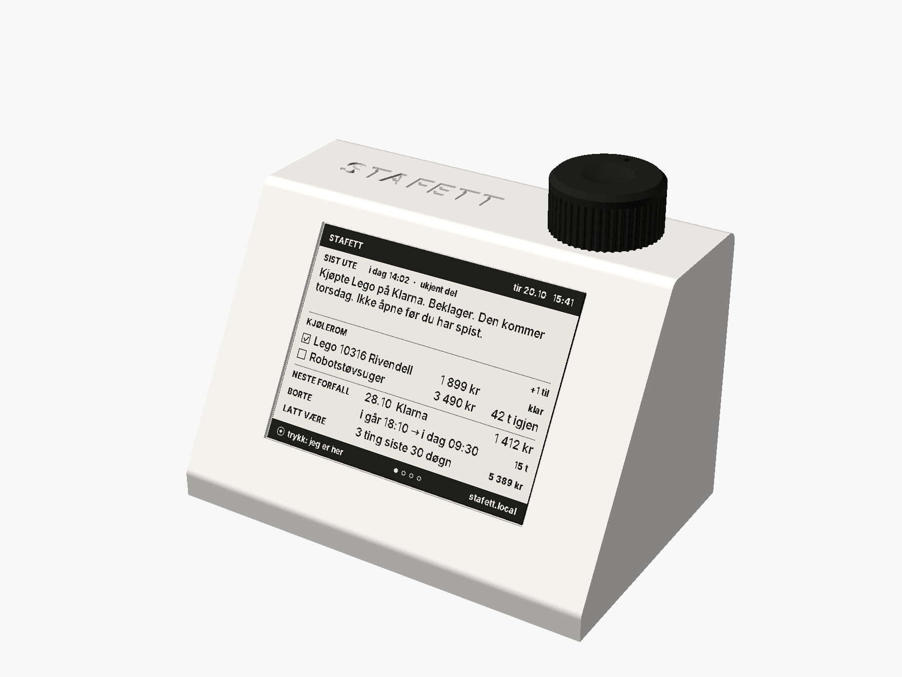
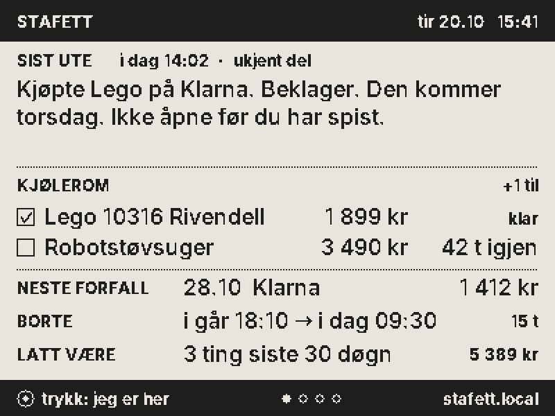
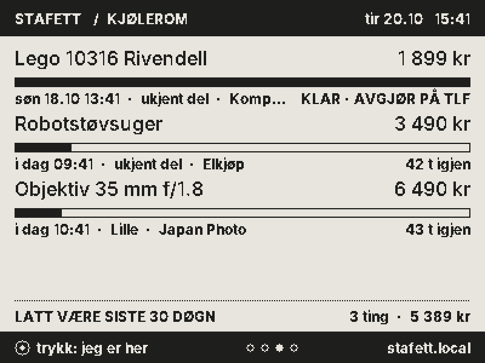
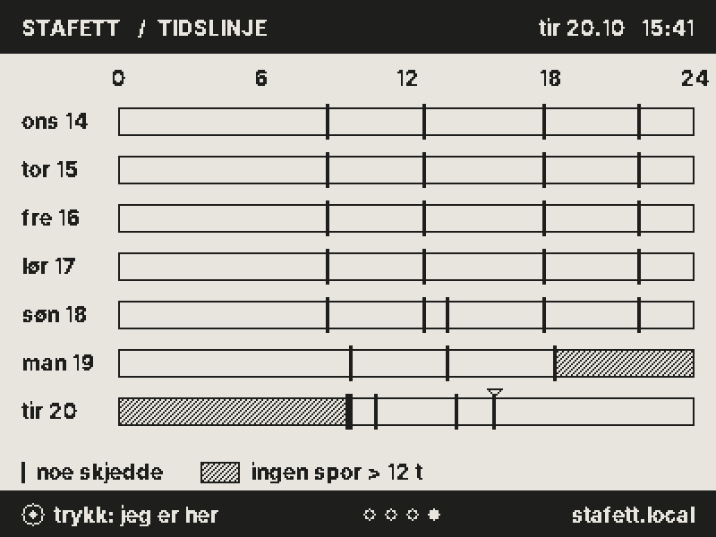
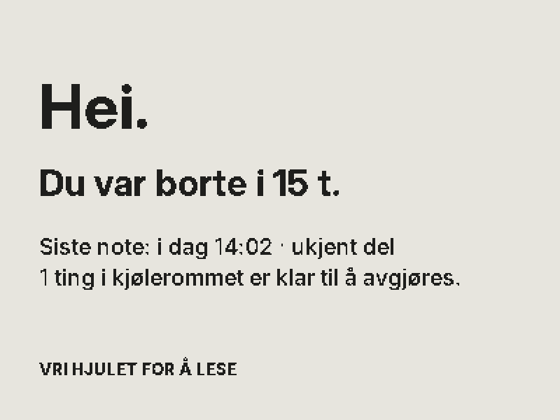

# STAFETT

*Den som tar over, får vite hva som skjedde.*



En e-blekk-kile på pulten for hoder med flere sjåfører. Viser siste overlevering, hva som ligger i 48-timers kjølerom, neste forfall, og hvor lenge du var borte. Ett hjul. Ingen sky. Ingen konto.

| | |
|---|---|
| Idé og drap | [`LAB.md`](LAB.md) |
| Spesifikasjon | [`SPEC.md`](SPEC.md) |
| Økonomi | [`okonomi/OKONOMI.md`](okonomi/OKONOMI.md) |
| Marked | [`marked/MARKED.md`](marked/MARKED.md) |
| Testrapport | [`HULL.md`](HULL.md) |

## Prøv det på 60 sekunder (uten maskinvare)

Krever `g++`, `make`, `python3` med Pillow.

```sh
cd firmware
make test        # 156 enhetstester med ASan/UBSan
make dev         # bygger vertsserveren
./build/devserver --nokkel demo --web web
```

Åpne **http://localhost:8048/sim#k=demo**. Til venstre: e-blekkskjermen, tegnet av den samme C++-koden som kjører på enheten. Til høyre: telefonen. Skriv en note, legg noe i kjølerommet, trykk **+48 t**, og se hva som skjer.

Ende-til-ende-test (Playwright, krever Chromium): `make e2e`.

## Bygg den

| Steg | Kommando / fil |
|---|---|
| Kabinett | `cad/out/skall.stl`, `bunn.stl`, `hjul.stl` — PETG, 0,2 mm, 3 vegger. Kilde: `cad/stafett.scad` |
| Renders | `cd cad && python3 render.py` (krever OpenSCAD + xvfb) |
| Tegning | `cd cad && python3 tegning.py` → `cad/render/tegning.png` |
| Firmware | `make -C firmware esp32` (krever arduino-cli + esp32-kjerne 3.3) → `firmware/build/esp32/stafett.ino.merged.bin` |
| Flash | `esptool.py --chip esp32c3 write_flash 0x0 firmware/build/esp32/stafett.ino.merged.bin` |
| Skjermer | `cd firmware && make render && python3 tools/demo.py` → `render/skjerm-*.png` |
| Økonomi | `python3 okonomi/modell.py` |

## Skjermene

| | |
|---|---|
|  |  |
|  |  |

## Arkitektur i én setning

All logikk ligger i `firmware/core/` (ren C++17, testet på vertsmaskin). ESP32-sketchen, vertsserveren og render-verktøyet er tynne skall rundt den samme kjernen. Det som er testet, er det som kjører.
