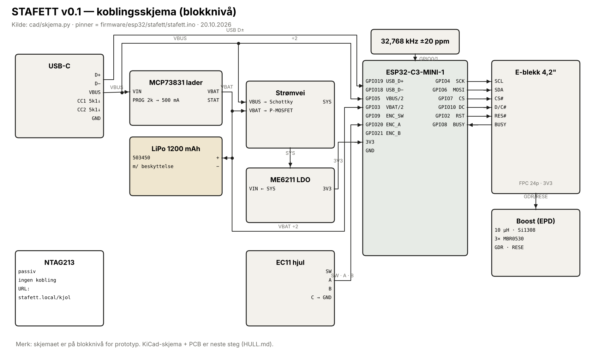

# STAFETT — netttabell v0.1

*Generert av `cad/skjema.py`. Pinner = `firmware/esp32/stafett/stafett.ino`.*

| Nett | Fra | Til | Merknad |
|---|---|---|---|
| `VBUS` | USB-C VBUS | MCP73831 VIN · Schottky → SYS · deler → GPIO5 | 5 V |
| `VBAT` | LiPo + | MCP73831 VBAT · P-MOSFET → SYS · deler → GPIO3 | 3,0–4,2 V |
| `SYS` | Schottky/P-MOSFET | ME6211 VIN | lastdeling: USB når den finnes |
| `3V3` | ME6211 VOUT | ESP32 3V3 · EPD VCI/VDDIO · EC11 pull-ups | 500 mA maks |
| `EPD_SCK` | ESP32 GPIO4 | FPC SCL | SPI 10 MHz |
| `EPD_MOSI` | ESP32 GPIO6 | FPC SDA |  |
| `EPD_CS` | ESP32 GPIO7 | FPC CS# |  |
| `EPD_DC` | ESP32 GPIO10 | FPC D/C# |  |
| `EPD_RST` | ESP32 GPIO2 | FPC RES# | strapping: ekstern 10k opp |
| `EPD_BUSY` | FPC BUSY | ESP32 GPIO8 | strapping: må være høy kun ved nedlasting |
| `EPD_GDR/RESE` | FPC GDR/RESE | boost: MOSFET-port / strømføler 2,2 Ω | som Waveshare-driverkort |
| `ENC_A` | EC11 A | ESP32 GPIO20 | intern pull-up, 10 nF til GND |
| `ENC_B` | EC11 B | ESP32 GPIO21 | intern pull-up, 10 nF til GND |
| `ENC_SW` | EC11 SW | ESP32 GPIO9 (BOOT) | hold ved USB-innsetting = nedlastingsmodus |
| `XTAL32` | 32,768 kHz krystall | ESP32 GPIO0/GPIO1 | 2× 12 pF |
| `USB_D±` | USB-C D+/D− | ESP32 GPIO19/GPIO18 | USB-CDC for logg og flash |
| `CC1/CC2` | USB-C CC | 5,1 kΩ til GND | ellers gir USB-C-ladere ingen strøm |

## Strapping-pinner på ESP32-C3 (hvorfor pinnene er der de er)

- **GPIO2, GPIO8, GPIO9** bestemmer oppstartsmodus. GPIO9 lav ved oppstart = nedlastingsmodus. Hjulknappen ligger der med vilje: *hold hjulet inne mens du setter i USB* = oppdater fastvaren. Ingen ekstra knapp.
- **GPIO0/1** går til 32 kHz-krystallen. Uten den driver klokka ±5 %, og en 48-timers nedtelling kan bomme med over to timer.
- **VBUS-deteksjon på GPIO5**, ikke GPIO9: ellers ville enheten startet i nedlastingsmodus hver gang den ble skrudd på fra batteri.
