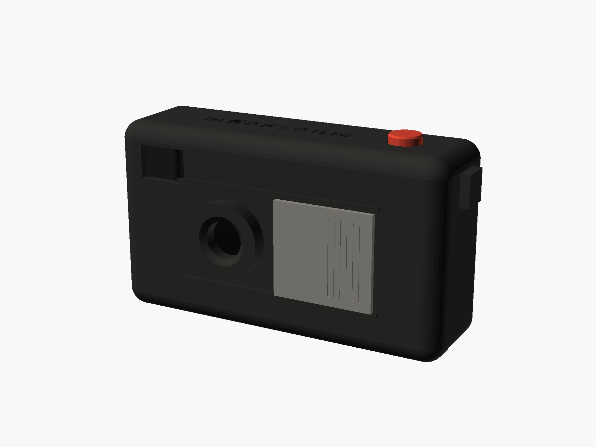
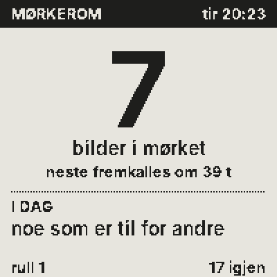
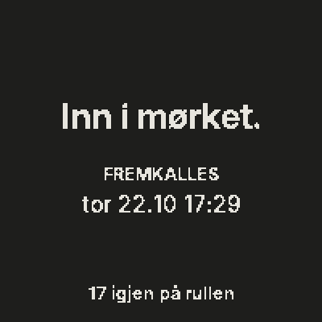
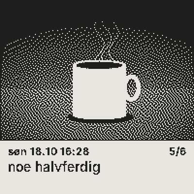
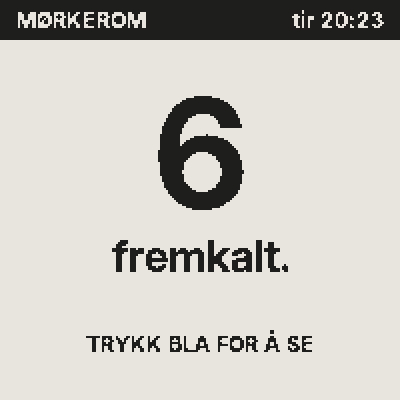
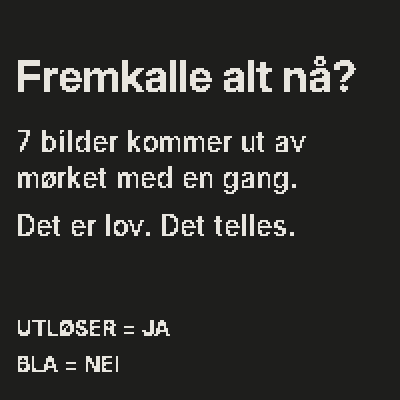
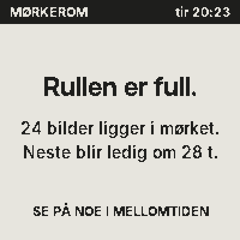

# MØRKEROM

*Ta bildet. La det ligge. Se det om 48 timer.*



Et kamera uten skjerm. Hvert bilde ligger i mørket i 48 timer, så fremkalles det som et kornete 1-bit-bilde på en e-blekk-rute bak. Hver morgen: ett oppdrag («noe som er varmt»). 24 bilder per rull. Bildene ligger kryptert på minnekortet og hentes til telefonen over kameraets eget nett, men først når de er fremkalt.

| | |
|---|---|
| Idé og drap | [`LAB.md`](LAB.md) |
| Spesifikasjon | [`SPEC.md`](SPEC.md) |
| Netttabell | [`SKJEMA.md`](SKJEMA.md) |
| Økonomi | [`okonomi/OKONOMI.md`](okonomi/OKONOMI.md) |
| Marked | [`marked/MARKED.md`](marked/MARKED.md) |
| Testrapport | [`HULL.md`](HULL.md) |

## Prøv det på 60 sekunder (uten maskinvare)

Krever `g++`, `make`, `libmbedtls-dev`, `python3` med Pillow og numpy.

```sh
cd firmware
make test                              # 2 290 sjekker med ASan/UBSan
python3 tools/eksempler.py             # seks prosedyriske «fotografier» kameraet kan se
make dev
./build/devserver --nokkel demo
```

Åpne **http://localhost:8064/sim#k=demo**. Åpne dekselet, trykk utløseren et par ganger, og se bildene forsvinne inn i mørket. Trykk **+48 t**. Trykk **bla**.

Ende-til-ende (Playwright): `make e2e`.

## Bakskjermen

| | | |
|---|---|---|
|  |  |  |
|  |  |  |

## Bygg det

| Steg | Kommando / fil |
|---|---|
| Kabinett | `cad/out/front.stl`, `bakdel.stl`, `deksel.stl`, `utloser.stl`, `bla.stl` — kilde: `cad/morkerom.scad` |
| Renders | `cd cad && python3 render.py` |
| Tegning | `cd cad && python3 tegning.py` |
| Firmware | `make -C firmware esp32` (ESP32-S3, OPI-PSRAM, 16 MB) |
| Skjermer | `cd firmware && make render && ./build/render tools/eksempler build/demo-sd && python3 tools/png.py build/demo-sd ../render` |
| Økonomi | `python3 okonomi/modell.py` · `python3 okonomi/strom.py` |

Felles kode med Stafett ligger i [`../felles/`](../felles): JSON, tid med sommertid, `Ramme<W,H>`, fonter, QR, test-HTTP-server.
