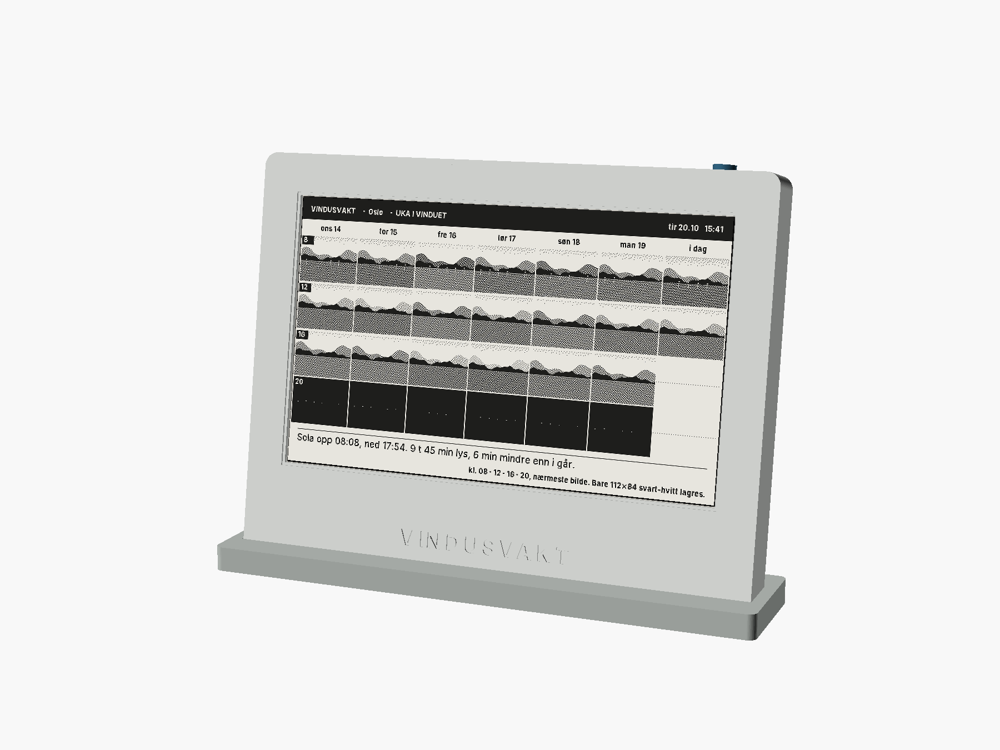
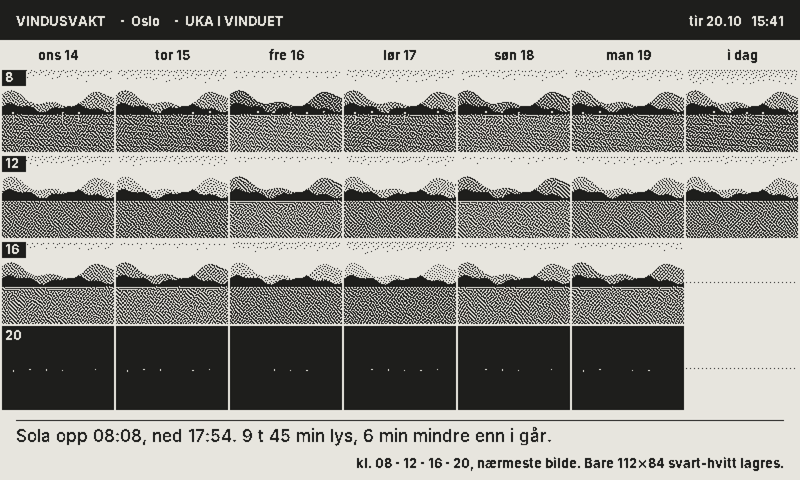
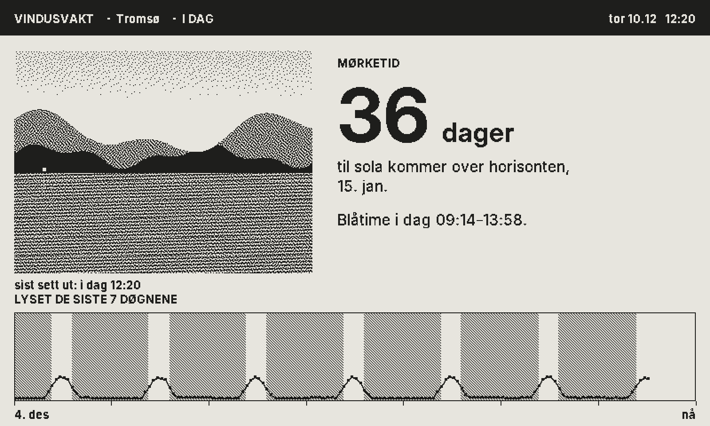
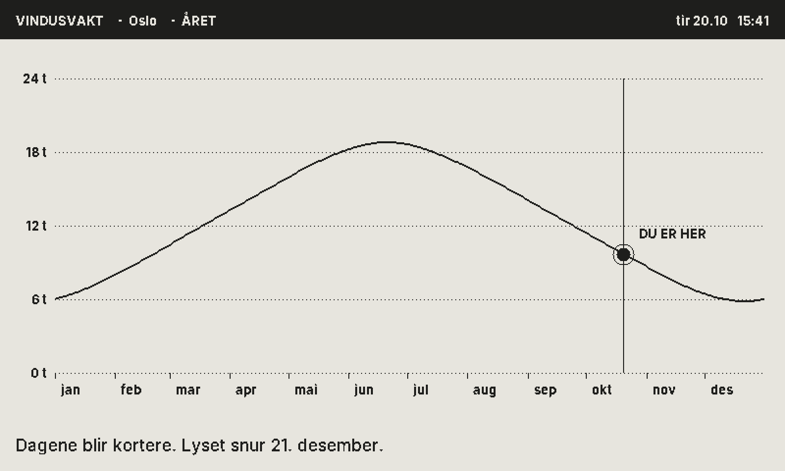
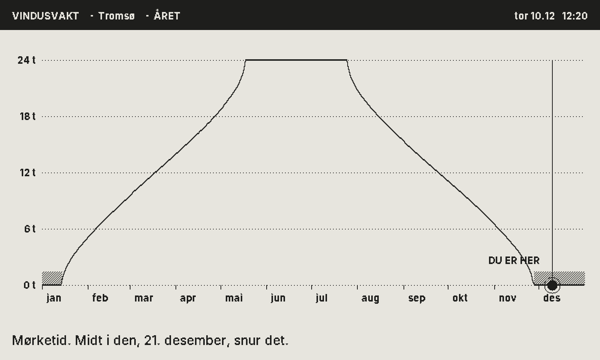

# VINDUSVAKT

*Verden fortsatte. Her er beviset.*



En 7,5" e-blekk-ramme i vinduskarmen. Kameraet bak ser ut av vinduet én gang i timen og beholder bare et lite svart-hvitt bilde. Foran: uka i vinduet, dagens lys, og i mørketida hvor mange dager det er til sola. Ett år på én lading.

| | |
|---|---|
| Idé og drap | [`LAB.md`](LAB.md) |
| Spesifikasjon | [`SPEC.md`](SPEC.md) |
| Økonomi | [`okonomi/OKONOMI.md`](okonomi/OKONOMI.md) |
| Marked | [`marked/MARKED.md`](marked/MARKED.md) |
| Testrapport | [`HULL.md`](HULL.md) |

## Prøv det

```sh
cd firmware
make test          # 125 sjekker
make dev
./build/devserver --nokkel demo
```

Åpne **http://localhost:8072/sim#k=demo**. Trykk **+7 døgn**, og se uka fylle seg. Velg Tromsø på telefonen, hopp fram til desember, og se tallet: dager til sola.

## Skjermene

| Oslo, oktober | Tromsø, 10. desember |
|---|---|
|  |  |
|  |  |

## Bygg

| | |
|---|---|
| Kabinett | `cad/out/*.stl` · kilde `cad/vindusvakt.scad` |
| Firmware | `make -C firmware esp32` |
| Skjermer | `cd firmware && make render && ./build/render && python3 tools/png.py build/skjermer ../render` |
| Økonomi | `python3 okonomi/modell.py` · `python3 okonomi/strom.py` |
