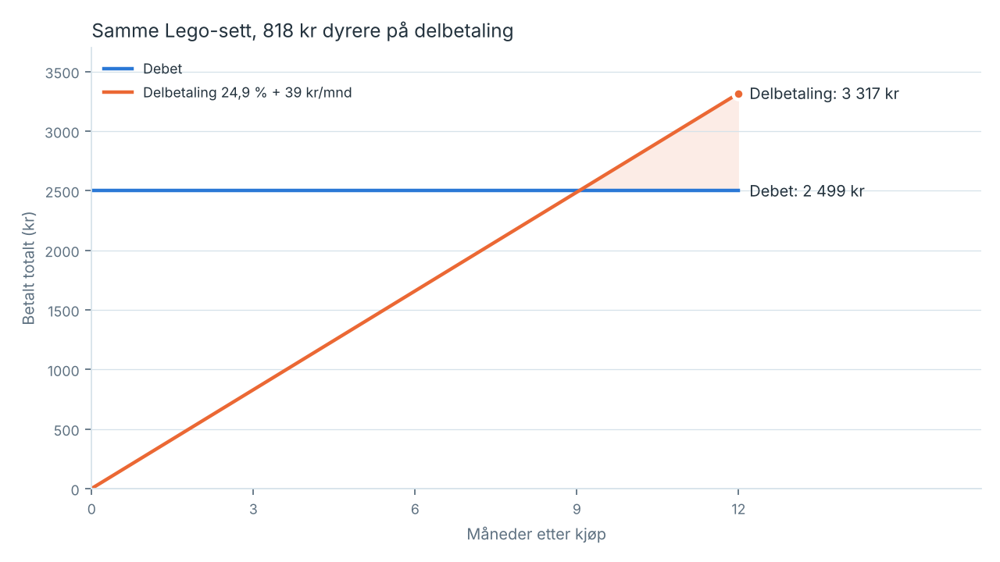

# 01 — KJØLEROM · Økonomi

Generert av `okonomi/kost.py`. Endre tall der, ikke her. (est.) = antakelse.

## 1. Hva et Lego-sett til 2 499 kr faktisk koster

| Betaling | Totalt | Per mnd | Ekstra |
|---|---:|---:|---:|
| Debet | 2 499 kr | — | 0 kr |
| Kredittkort 22 %, 12 mnd | 2 807 kr | 234 kr | 308 kr |
| Delbetaling 24,9 % + 39 kr/mnd, 12 mnd | 3 317 kr | 276 kr | 818 kr |

## 2. Rentedager

Med 250 000 kr gjeld à 18 % (est.) brenner det **123 kr per dag**, **3 699 kr per måned**, før en eneste krone er avdrag.
Lego-settet på delbetaling = **26,9 rentedager**. Det er tallet appen viser. Ikke for å skremme. For å gjøre en abstrakt rente til en kalender.

## 3. Kortkappe — enhetsøkonomi (B2C, sendt i posten)

| Post | Kost |
|---|---:|
| PETG 11,2 g à 0,25 kr/g (est. 250 kr/kg) | 2.80 kr |
| Strøm 120 W × 16 min à 1,50 kr/kWh (est.) | 0.05 kr |
| Printer-slitasje (dyse/plate) (est.) | 1.00 kr |
| QR-klistremerke + etikett (est.) | 1.50 kr |
| Boblekonvolutt C6 (est.) | 6.00 kr |
| Porto brev ≤ 50 g innland (est. — sjekk posten.no) | 30.00 kr |
| **Sum vareforbruk + frakt** | **41.35 kr** |

Pris **149 kr** inkl. mva og frakt → netto 119.20 kr → **dekningsbidrag 77.85 kr/stk** (65 %).
Printer 3 000 kr (est.) er tjent inn etter **39 kapper**. Kapasitet én printer: ~72 stk/døgn (6 per plate, ~80 min).

Porto er 73 % av kostnaden. Plast er 7 %. Produktet er i praksis gratis å lage; det er *frakten* som koster. Derfor: STL-fila er gratis, alltid.

## 4. B2B — gjeldsrådgivere kjøper i bulk

Bulk à 49 kr inkl. mva, 100 stk per pakke: vareforbruk 7.35 kr/stk → **dekningsbidrag 31.85 kr/stk**, 3 185 kr per ordre.
Kjøper: NAV økonomirådgivning, kommunal gjeldsrådgivning, Kirkens Bymisjon, Frelsesarmeen, DPS-poliklinikker. De gir den bort i første samtale. Ett fysisk objekt som tar med seg samtalen hjem.

## 5. År 1 — tre scenarioer

| Scenario | B2C-kapper | B2B-ordre (100 stk) | Dekningsbidrag | Minus printer |
|---|---:|---:|---:|---:|
| Stille | 150 | 0 | 11 678 kr | 8 678 kr |
| Basis | 600 | 2 | 53 082 kr | 50 082 kr |
| Treffer | 2500 | 8 | 220 112 kr | 217 112 kr |

Ærlig konklusjon: dette er ikke en enhjørning. Det er et verktøy som kan betale for seg selv, en printer og noen kvelder — og som kan holde **tusenvis av kroner i rente** ute av ett menneskes liv per år. Verdien sitter hos brukeren, ikke hos selgeren. Det er riktig vei rundt.
