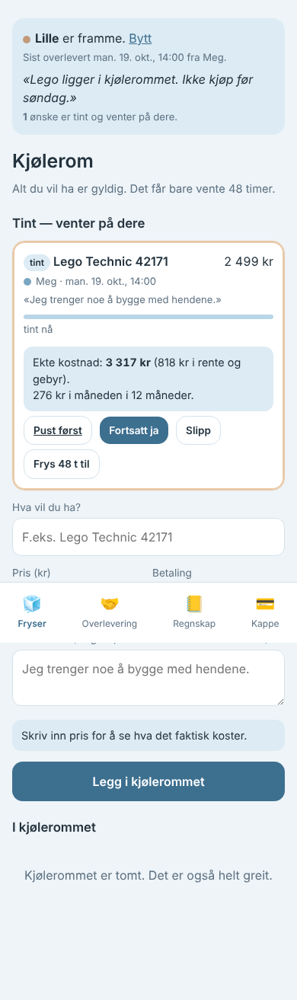
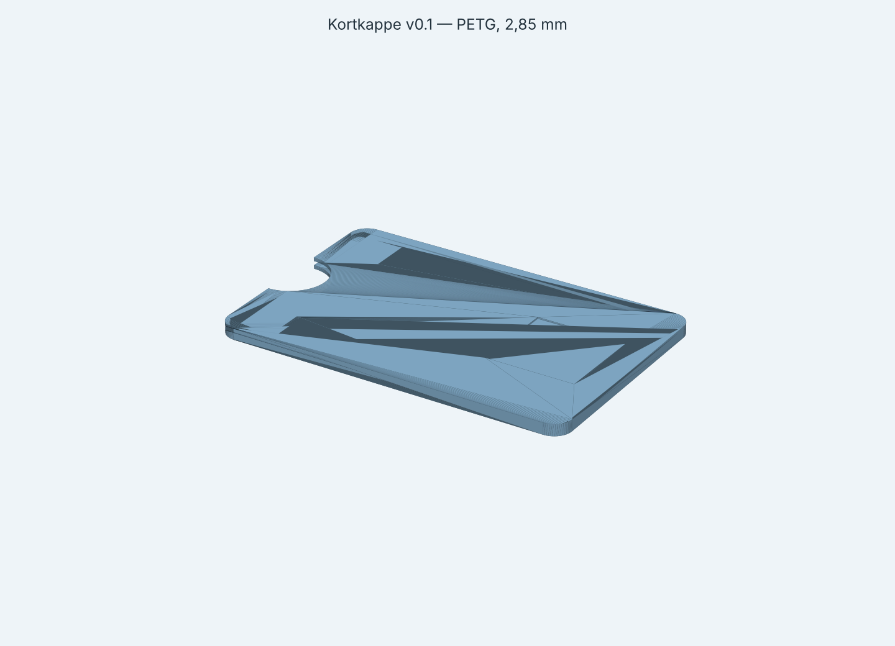

# 01 — Kjølerom + Kortkappe

> Alt du vil ha er gyldig. Det får bare vente 48 timer.

Et lokal-first kjøleskap for kjøp, bygd for systemer der den som kjøper og den som betaler ikke er samme del.

 

| Fil | Hva |
|-----|-----|
| [`IDE.md`](IDE.md) | Labben-kjøring: seed 7, drept 5, IRP på overlevende |
| [`SPEC.md`](SPEC.md) | Krav, datamodell, mekanisk spesifikasjon, risiko |
| [`kjolerom.html`](kjolerom.html) | Appen. Én fil, null nettverk |
| [`cad/kortkappe.py`](cad/kortkappe.py) → `kortkappe.stl` | Parametrisk CAD, vanntett mesh, rapport |
| [`OKONOMI.md`](OKONOMI.md) ← `okonomi/kost.py` | Ekte kostnad, rentedager, enhetsøkonomi, scenarioer |
| [`MARKED.md`](MARKED.md) | Marked, konkurrenter, kanaler, regulatorisk, kilder |
| [`FELTRAPPORT.md`](FELTRAPPORT.md) | Gonzo |

## Kjør

```bash
open products/01-kjolerom/kjolerom.html            # appen
node products/01-kjolerom/test/kjolerom.test.mjs   # 16 tester (playwright)
python3 products/01-kjolerom/cad/kortkappe.py      # STL + bilder (trimesh, manifold3d, shapely, matplotlib)
python3 products/01-kjolerom/okonomi/kost.py       # OKONOMI.md + graf
```

## Status v0.1

- [x] App: fryser, tining, overlevering, regnskap, kappe-etikett, eksport/import, .ics
- [x] 16/16 tester: 48t-klokke, XSS, ødelagt lagring, 320px, null nettverk, ingen skamspråk
- [x] CAD: vanntett, 11,2 g, 60 µm klem beregnet
- [ ] Fysisk print + kalibrering av rygg (0,25 / 0,35 / 0,45)
- [ ] Test med ekte flersystem-brukere (ikke før samtykke og trygg ramme)
