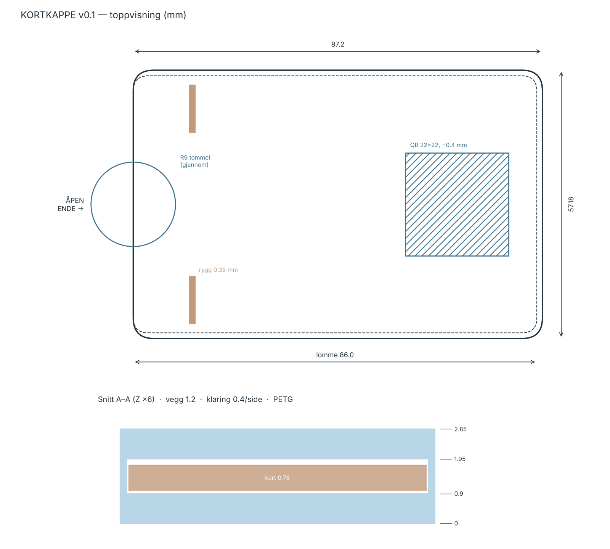
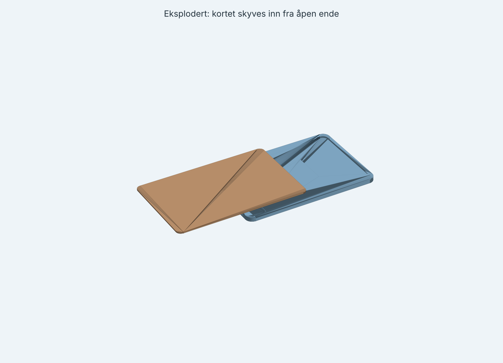

# 01 — KJØLEROM · Spesifikasjon v0.1

To deler, én kropp:

| Del | Hva | Fil |
|-----|-----|-----|
| **Kjølerom** (app) | Lokal-first PWA-lignende HTML. Fryser ønsker i 48t, viser ekte kostnad, overlevering mellom deler. | `kjolerom.html` |
| **Kortkappe** (fysisk) | 3D-printet hylse over bankkort. Skjuler kortnummer + CVC. Setning fra en annen del på innsiden. QR til Kjølerom. | `cad/` |

## 1. Brukerhistorier

1. *Som en del som vil ha noe nå*, legger jeg det i fryseren på under 20 sekunder, uten å bli dømt.
2. *Som en del som våkner etter et tidstap*, ser jeg med én gang hvem som var framme sist, hva de ville og lappen de la igjen.
3. *Som systemet*, ser vi hva vi har latt være å kjøpe og hvor mye rente vi ikke betalte.
4. *Som den som holder kortet*, må jeg fysisk ta av kappen og lese en setning før jeg kan taste kortnummer.

## 2. Funksjonelle krav

| ID | Krav | Akseptanse |
|----|------|-----------|
| F1 | Legg inn ønske: hva, pris, betalingsmåte, hvorfor (valgfritt), hvem er framme | Lagres i `localStorage['kjolerom.v1']`, vises i Fryseren |
| F2 | Kjøletid default 48t, justerbar 1–168t | `unlockAt = createdAt + hours*3600e3` |
| F3 | Ekte kostnad: annuitet for delbetaling, kortrente for kreditt, gebyr per termin | Matcher `okonomi/kost.py` innen 1 kr |
| F4 | «Rentedager»: pris ÷ daglig rente på eksisterende gjeld | Vises hvis gjeld er satt |
| F5 | Tint etter utløp: *Fortsatt ja* / *Slipp* / *Frys 48t til* | Status `bought` / `released` / ny `unlockAt` |
| F6 | Beslutning logger hvem som var framme | `decidedBy` ≠ null |
| F7 | Overlevering: «Hvem er framme?» + lapp til neste | Siste lapp vises øverst ved åpning |
| F8 | Regnskap: sum kjølt bort, rente unngått, sum kjøpt | Tall oppdateres live |
| F9 | Eksport/import JSON + `.ics` kalender-påminnelse for tining | Ingen nett |
| F10 | Kortkappe-setning + utskrivbar etikett 85,6 × 54 mm | `@media print` |
| F11 | Lenke til Pusterom før beslutning | `index.html#pusterom` |

## 3. Ikke-funksjonelle krav

- **Null nettverk.** Ingen fetch, ingen CDN, ingen font-lasting. Én fil.
- **Ingen skamspråk.** Forbudt i UI: *impuls, feil, synd, dårlig, svak, avhengig*. Testet automatisk.
- **Tilgjengelighet.** Alle knapper har tekst. Kontrast ≥ 4.5:1. Fungerer på 320px.
- **Mørk modus** via `prefers-color-scheme`.
- **Ikke medisinsk utstyr.** Ingen diagnose, ingen behandling, ingen påstand om effekt.

## 4. Datamodell

```js
{
  v: 1,
  settings: { hours: 48, cardApr: 22, debt: 0, debtApr: 0, sentence: "" },
  parts:   [{ id, name, color }],
  front:   "partId",
  handovers: [{ t, from, to, note }],
  wishes:  [{ id, title, price, pay: "debet"|"kort"|"delbetaling",
              months, apr, fee, why, partId, createdAt, unlockAt,
              status: "frozen"|"bought"|"released",
              decidedAt, decidedBy, refreezes }]
}
```

## 5. Kortkappe — mekanisk spesifikasjon

| Parameter | Verdi | Begrunnelse |
|-----------|-------|------------|
| Kort (ISO/IEC 7810 ID-1) | 85,60 × 53,98 × 0,76 mm | Standard |
| Innvendig lomme | 86,0 × 54,78 × 1,05 mm | +0,4 mm klaring per side (åpen ende har ingen vegg) |
| Vegg | 1,2 mm (3 perimetre à 0,4) på langsider + lukket ende | Stiv nok, lett å bøye ut kortet |
| Bunn / topp | 0,9 mm hver | 4–5 lag à 0,2 mm |
| Total | 87,2 × 57,18 × 2,85 mm | Passer i vanlig lommebok-kortlomme (≈ 90 mm bred) |
| Tommelutsparing | Halvsirkel R 9 mm på åpen kortside | Kortet må *skyves* ut — 1–2 s friksjon |
| Brikkevindu | Ingen | Kontaktløs (NFC) virker gjennom 1 mm plast — butikkbetaling ok, nettkjøp krever avtaking |
| Friksjonsrygger | 2 × 0,35 × 1,2 × 10 mm under taket, 12 mm inn | Smalner lomma til 0,70 mm mot kort 0,76 → 60 µm klem. Kortet faller ikke ut selv |
| QR-felt | 22 × 22 mm forsenket 0,4 mm | Klistremerke eller to-farge print. Restvegg over lomma 0,5 mm — svakeste punkt, se risiko |
| Setning | Etikett fra appen (85,6 × 54 mm) limt på kortets bakside *eller* kappens underside. Gravering = v0.2 | Leses når kortet trekkes ut |
| Materiale | PETG (anbefalt), PLA ok | PETG tåler lommebok-varme |
| Printtid | ≈ 16 min @ 0,2 mm lag | Se `cad/rapport.txt` |
| Vekt | 11,2 g PETG (8,81 cm³) | Beregnet fra mesh, se `cad/rapport.txt` |

**Designvalg som er verdt å forsvare:** kappen blokkerer *ikke* kontaktløs betaling.
Butikk-kjøp er sjelden problemet. Problemet er 16 sifre tastet inn kl 02:40.
Kappen dekker sifrene og CVC; NFC virker fortsatt. Friksjon der det teller, ingen der det ikke gjør det.

### Kjente risikoer v0.1 (før fysisk test)

1. **0,5 mm restvegg under QR-feltet** kan sprekke ved bøy i bakre bukselomme. Tiltak v0.2: QR som klistremerke uten forsenkning, eller tak 1,1 mm.
2. **60 µm klem** er beregnet, ikke målt. FDM-toleranse er ±0,1 mm. Første print kan være for løs eller for stram → print testbrikke med rygg 0,25 / 0,35 / 0,45.
3. **Kortet stikker ikke ut.** Tommelhull R9 gjennom begge plater er eneste grep. Må testes med kalde fingre.



