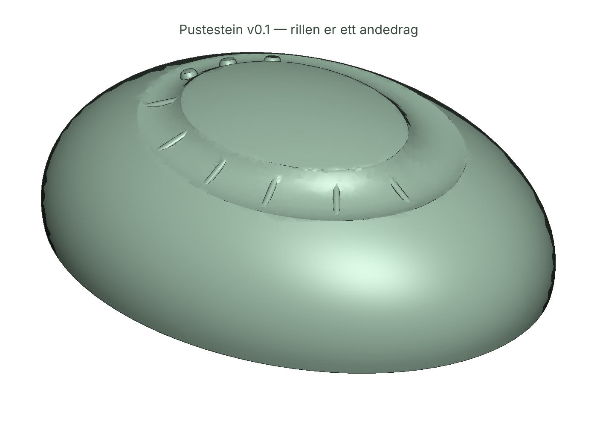

# 02 — Pustestein

> En stein med et spor for tommelen som er like langt som ett rolig andedrag.

Pusterom-sirkelen (4–2–6) tatt ut av skjermen og inn i hånda. Vekt, rytme, og ett bilde under.



| Fil | Hva |
|-----|-----|
| [`IDE.md`](IDE.md) | Labben: seed 7, drept 5, parkert 1, IRP |
| [`SPEC.md`](SPEC.md) | Taktil kode, mekanikk, app-krav, risiko |
| [`pustestein.html`](pustestein.html) | Guide · kalibrering · bilde · `parametre.json` |
| [`cad/pustestein.py`](cad/pustestein.py) | Parametrisk CAD → `pustestein.stl`, `ramme.stl`, `rapport.txt` |
| [`OKONOMI.md`](OKONOMI.md) ← `okonomi/kost.py` | Leser CAD-rapporten |
| [`MARKED.md`](MARKED.md) | Naboer, evidens, segmenter, regulatorisk, kilder |
| [`FELTRAPPORT.md`](FELTRAPPORT.md) | Gonzo |

## Kjør

```bash
open products/02-pustestein/pustestein.html
python3 products/02-pustestein/cad/pustestein.py [parametre.json]
node products/02-pustestein/test/pustestein.test.mjs     # 14 tester, ende-til-ende app → CAD
python3 products/02-pustestein/okonomi/kost.py
```

## Status v0.1

- [x] CAD: vanntett, min. vegg 1,69 mm, 195 g stål, pause Z=20, rest-luft 0,5 %
- [x] App: guide, kalibrering (stående kort), tommel-sporing, bilde @ 300 dpi, JSON
- [x] Ende-til-ende-test: simulert tommel → JSON → STL
- [ ] Fysisk print, testbrikke med tre rillelengder
- [ ] Sammenlign kalibrert fart på glass vs PLA
