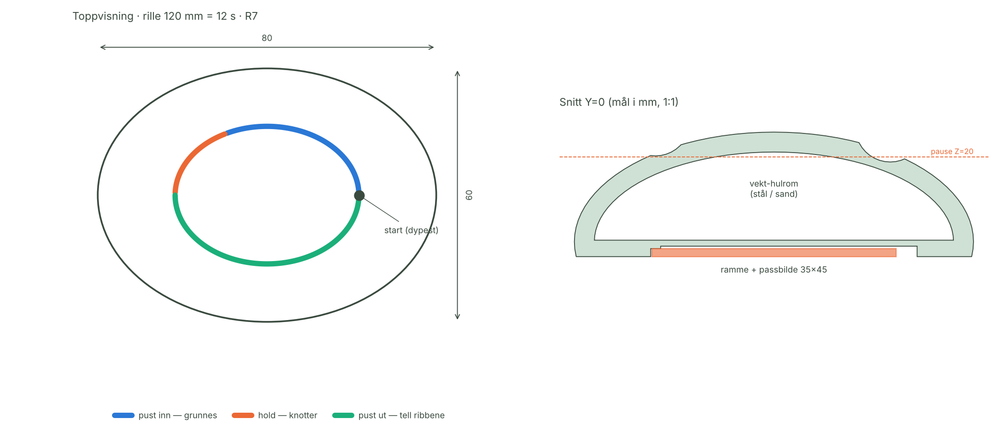
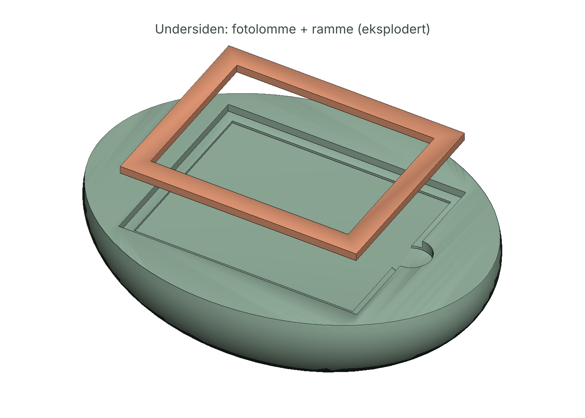

# 02 — PUSTESTEIN · Spesifikasjon v0.1

| Del | Hva | Fil |
|-----|-----|-----|
| **Stein** | Ellipsoide 80 × 60 × 25 mm, tommelrille = ett andedrag, vekt-hulrom, fotolomme | `cad/pustestein.stl` |
| **Ramme** | Holder passbildet i bunnen, vindu 41 × 31 | `cad/ramme.stl` |
| **App** | Guide, tommel-kalibrering, bildebeskjæring, `parametre.json` | `pustestein.html` |
| **CAD-skript** | Leser `parametre.json`, bygger alt, sjekker vegg og vanntetthet | `cad/pustestein.py` |

Flyt: **app måler tommelen → `parametre.json` → CAD bygger *din* stein → print.** Testet ende-til-ende i `test/pustestein.test.mjs`.

## 1. Taktil kode (rillen)

| Fase | Tid | Lengde @ 10 mm/s | Dybde | Kjennes som |
|------|----:|---------:|------|------|
| Pust inn | 4 s | 40 mm | 2,2 → 0,9 mm | Tommelen *løftes* — rillen grunnes |
| Hold | 2 s | 20 mm | 0,9 mm | 3 knotter (R 1,3) — start, midt, slutt |
| Pust ut | 6 s | 60 mm | 0,9 → 2,2 mm | 6 tverr-ribber (R 0,5) — én per sekund, tell dem |
| Start | — | — | 2,2 mm | Dypeste punkt = start. Finnes i mørket |

Rytme 4–2–6 = 12 s = **5 pust/min**, samme som Pusterom-sirkelen i `index.html`, og nær ~6/min som HRV-litteraturen omtaler som resonansfrekvens (se MARKED.md). Ingen helsepåstand.

Rillelengde `L = fart × (inn + hold + ut)`. Sløyfa er en ellipse med samme 4:3-forhold som steinen, skalert med `k = L / 221,0 mm`. Gyldig `k` 0,30–0,80 → `L` 66–177 mm. Appen og CAD-skriptet bruker samme konstanter og samme grense; appen sperrer nedlasting utenfor.

## 2. Mekanikk

| Parameter | Verdi | Begrunnelse |
|-----------|-------|------------|
| Kropp | Ellipsoide a=40, b=30, c=22, sentrum Z=3, kuttet Z=0 | Bunnkant under ekvator → myk, ikke skarp |
| Rillekule | R 7 (R 6 / R 8 valgbart) | Tommelpute-bredde |
| Rille-fres | Kulesenter **R − d over** rillebunnen | v0.0 hadde fortegnsfeil → skar gjennom skallet. Funnet i snittegning, fikset, nå sikret av vegg-sjekk |
| Skall over hulrom | 4,0 mm | Min. vegg under rille **1,69 mm** (krav ≥ 1,2) — `min_gap` i CAD |
| Hulrom | 34,3 cm³, Z 3,3–21 | Stålhagl → **195 g**, sand → 89 g |
| Pause-at-height | Z = 20,0 mm | Hell til kanten, fortsett. Rest-luft 0,16 cm³ (0,5 %) → ingen rangling |
| Fotolomme | 45,4 × 35,4 × 0,5 (bilde) over 49,4 × 39,4 × 1,6 (ramme) | Passbilde-format; ramme friksjonsfit 0,2/side + tommelhakk R4 |
| Print | ~56 min, 0,2 mm, uten støtte | Flat bunn på platen; lommene er åpne nedover = ingen overheng |

## 3. App

| ID | Krav | Test |
|----|------|------|
| A1 | Guide 4–2–6 med prikk langs rillen, fase og ribbe-teller | klokke-styrt test |
| A2 | Vibrasjon ved fase-skifte (Android) for øyne lukket | manuell |
| A3 | Kalibrering: *stående* bankkort (54 mm passer på 320 px ved 6 px/mm) | 390 px-test |
| A4 | Tommel-fart: 3 hele runder, median, målt i skjerm-px ÷ px/mm | simulert sporing ±8 % |
| A5 | Halve runder (< 85 %) eller < 3 s avvises | test |
| A6 | Bilde 45 × 35 / 35 × 45 mm @ 300 dpi (531 × 413 px), 6 stk på A4 i eksakt mm | test |
| A7 | `parametre.json` → CAD-skriptet bygger vanntett stein | ende-til-ende |
| A8 | Null nettverk, ingen JS-feil, 320 px uten horisontal scroll | test |

## 4. Kjente risikoer før fysisk test

1. **Tommelfart på glass ≠ på PLA.** Friksjon er høyere på plast. Kalibreringen kan gi for lang rille. Tiltak: print testbrikke med tre rillelengder (−15 %, 0, +15 %).
2. **Stålhagl + PLA ved 60 °C (bil i sola)** → PLA mykner. Anbefal PETG for steiner som skal bo i bil/lomme.
3. **Ribber R 0,5** kan bli utydelige ved 0,2 mm lag. Test 0,12 mm lag på toppen (variabel laghøyde).
4. **Bilde av avdød** kan være tungt. Rammen kan printes uten vindu (massiv) og bildet byttes når som helst.

