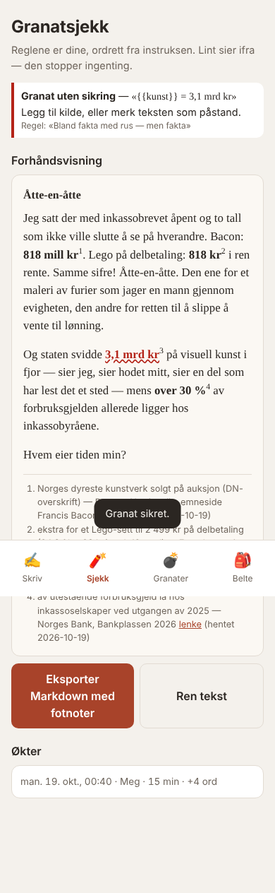
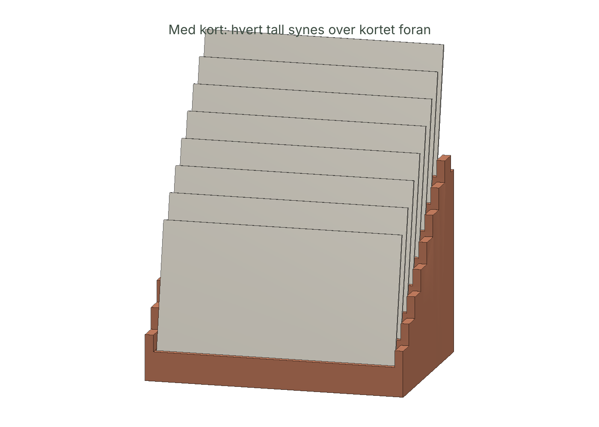

# 03 — Granatbelte

> Hver granat har sikring: tall, påstand, kilde, dato.

Skrivemaskin for gonzo med faktakort, rå-modus uten sletting, og lint som kjører *dine* regler ordrett. Pluss et trappestativ for 8 granatkort.

 

| Fil | Hva |
|-----|-----|
| [`IDE.md`](IDE.md) | Labben: seed 7, drept 6, IRP |
| [`SPEC.md`](SPEC.md) | Datamodell, lint-regler, rå-modus, eksport, stativ |
| [`granatbelte.html`](granatbelte.html) | Appen |
| [`cad/granatbelte.py`](cad/granatbelte.py) | Stativ med asserts (kollisjon, synlig bånd, gulv) |
| [`OKONOMI.md`](OKONOMI.md) | Belte, klassesett, scenarioer |
| [`MARKED.md`](MARKED.md) | Faktasjekk av instruksens egne tall, naboer, kilder |
| [`FELTRAPPORT.md`](FELTRAPPORT.md) | Gonzo |

```bash
node products/03-granatbelte/test/granatbelte.test.mjs   # 16 tester
python3 products/03-granatbelte/cad/granatbelte.py [N]
```
