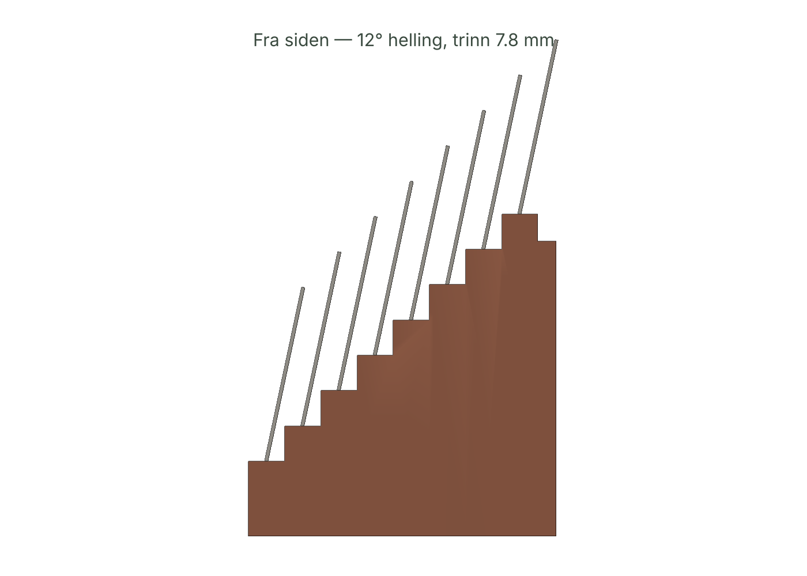

# 03 — GRANATBELTE · Spesifikasjon v0.1

| Del | Hva | Fil |
|-----|-----|-----|
| **Skrivemaskin** | Utkast, rå-modus uten sletting, granater som `{{navn}}`, gonzo-lint, fotnote-eksport | `granatbelte.html` |
| **Granatkort** | ID-1 (85,6 × 54), tall i 7 mm-bånd øverst, påstand + kilde + dato under | utskrift fra appen |
| **Stativ** | Trappestativ for 8 kort, 12° helling, hvert tallbånd synlig | `cad/granatbelte.stl` |

## 1. Granat (datamodell)

```js
{ slug: "bacon", value: "84,6", unit: "mill USD",
  claim: "Bacon-triptyk … solgt hos Sotheby's i 2020",
  source: "Sotheby's pressemelding", url: "https://…", fetched: "2026-10-19",
  trust: "primær" | "sekundær" | "egen" | "uverifisert", note: "" }
```

- Ingen kilde og ingen lenke → tvinges til `uverifisert` (unntak: `egen` beregning).
- Lenker må være `http(s)://` — `javascript:` avvises ved lagring *og* ved import.
- Omdøping av en granat skriver om `{{gammelt}}` → `{{nytt}}` i alle utkast.

## 2. Lint — reglene, ordrett fra instruksen

| Regel | Alvor | Utløses av | Sitat |
|-------|-------|-----------|-------|
| Usikret granat | rød | Tall med enhet (mrd, mill, %, kr, USD, mph …) utenfor `{{}}` | «Grav tallene … bruk dem som granater» |
| Granat uten sikring | rød | `{{x}}` der x er uverifisert/kildeløs | |
| Ukjent granat | rød | `{{x}}` uten kort | |
| Intro | gul | Første setning starter «I dag», «Jeg tenkte», «Hei» … | «Start midt i helvete. Ikke intro.» |
| Tredjeperson | gul | > 200 tegn uten jeg/meg/min | «Førsteperson. Alltid.» |
| Begge sider | gul | «på den ene siden», «nyansert bilde» … | «Ingen objektivitet. Ingen begge sider.» |
| Filler | gul | egentlig, liksom, på en måte, ganske, faktisk … (hele ord) | «Hver setning må kutte.» |
| Pen slutt | gul | Siste avsnitt: «takk for at du leste», «alt i alt» … | «Slutt aldri pent.» |

Årstall uten enhet (2024) er ikke granater. Lint stopper ingenting.

## 3. Rå-modus

«Lite redigering. Første utkast er ofte best. Thompson sendte sider revet fra notatboken under deadline.»

- Timer 5–45 min. Blokkerer Backspace, Delete, Ctrl/Cmd+Z/X, klipp ut, dra-slipp, `beforeinput` delete/undo (mobil), og overskriving av markert tekst.
- Skriving og liming virker. Lagres hvert 0,6 s.
- Ved frist: «Deadline. Send det ut før det blir pent.» Økt logges med ord skrevet og *hvem som var framme* (leser delene fra Kjølerom hvis de finnes på samme enhet).

## 4. Eksport

- Markdown: `818 mill kr[^1]`, fotnoter med påstand — kilde — lenke (hentet dato). Kildeløse: `3,1 mrd kr [KILDE MANGLER][^3]` og `[^3]: KILDE MANGLER — …`. Aldri skjult.
- Ren tekst, JSON (alt), kortutskrift 85,6 × 54 mm (målt i test).

## 5. Stativ

| Parameter | Verdi | Begrunnelse |
|-----------|-------|------------|
| Kort | 8 × ID-1 | Samme format som Kortkappen |
| Spor | 1,3 × 9 mm, 12° bakover | Tar laminert papir og plastkort |
| Trinn | 7,83 mm opp / 8 mm bak | = (7 mm bånd + 1 mm luft) · cos 12° → hvert tall synlig |
| Første trinn | 10,5 mm | Sporet + 1,6 mm gulv. v0.0 hadde 5 mm → kortet stakk ut under bunnen. Nå assert i CAD |
| Mål | 92,8 × 68 × 71,3 mm | Står foran skjermen |
| Masse / print | ~102 g PLA @ 15 % · ~158 min | Selvbærende, ingen støtte |
| Føtter | 4 × Ø10 × 1 mm lommer | Filt/gummi |

CAD-skriptet feiler hvis: kort kolliderer, tallbåndet skjules, gulv < 1,6 mm, eller kort stikker under Z = 0.5.



