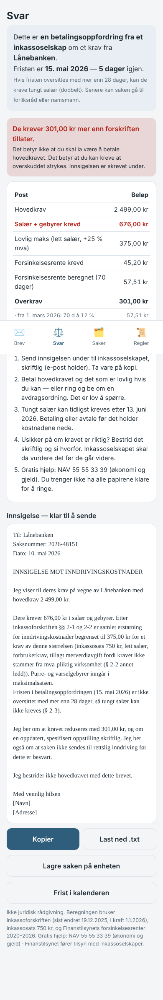
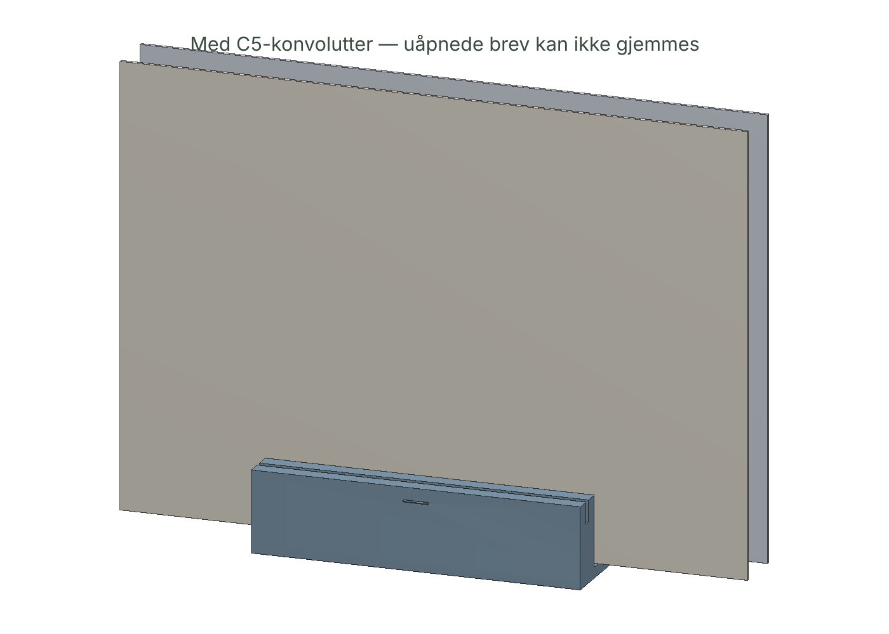

# 04 — Brevvakt + Brevhylle

> Du har åpnet brevet. Det var det vanskeligste.

Lim inn inkassobrevet. Brevvakt finner beløpene, regner lovlig maks salær og forsinkelsesrente etter inkassoforskriften (sist endret 19.12.2025), viser overkrav, og skriver innsigelsen. Brevhylla gjør det umulig å gjemme brev — og har en brevåpner der ingen finger når bladet.

 

| Fil | Hva |
|-----|-----|
| [`IDE.md`](IDE.md) | Labben: seed 7, drept 5, organ 1, IRP |
| [`SPEC.md`](SPEC.md) | Lovmotor med hjemler, utlesing, svar, hylle |
| [`brevvakt.html`](brevvakt.html) | Appen |
| [`cad/brevhylle.py`](cad/brevhylle.py) | Hylle med sikkerhets-asserts for bladet |
| [`OKONOMI.md`](OKONOMI.md) | Følsomhetsregnestykke på 9,16 mill saker, hylle |
| [`MARKED.md`](MARKED.md) | Finanstilsynets inkassostatistikk, naboer, kilder |
| [`FELTRAPPORT.md`](FELTRAPPORT.md) | Gonzo |

```bash
node products/04-brevvakt/test/brevvakt.test.mjs   # 15 tester, alle referanser regnet for hånd fra forskriften
python3 products/04-brevvakt/cad/brevhylle.py
```

**Ikke juridisk rådgivning.** Gratis hjelp: NAV 55 55 33 39.
