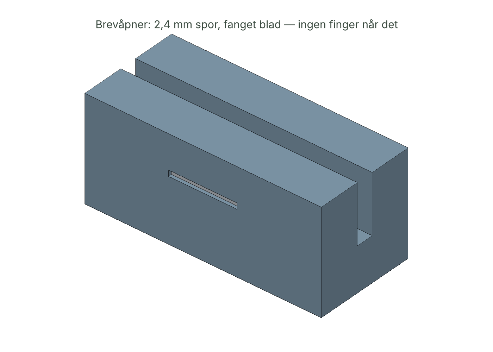

# 04 — BREVVAKT · Spesifikasjon v0.1

| Del | Hva | Fil |
|-----|-----|-----|
| **Brevvakt** | Lim inn brev → utlesing → sjekk mot inkassoforskriften → overkrav → innsigelse | `brevvakt.html` |
| **Brevhylle** | Uåpnet (foran, synlig) / Håndtert (bak) + fanget brevåpner | `cad/brevhylle.stl` |

## 1. Lovmotor (verifisert 19.–20.10.2026)

Kilde: Lovdata, inkassoforskriften FOR-1989-07-14-562, sist endret 19.12.2025 nr. 2709, i kraft 1.1.2026. Finanstilsynet for inkassosats og forsinkelsesrente.

| Konstant | Verdi | Hjemmel |
|----------|------:|---------|
| Inkassosats 2026 | 750 kr | § 1-2, Finanstilsynet |
| Purring / inkassovarsel | 38 kr (1/20) | § 1-2 |
| Betalingsoppfordring fra kreditor | 113 kr (3/20) | § 1-2 |
| Tungt salær | frist i betalingsoppfordring oversittet med **mer enn** 28 dager | § 2-3 |
| Ikke-forbruker | × 1,5 | § 2-1 |
| Kreditor ikke mva-pliktig | + 25 % | § 2-2 annet ledd |
| Avdrag > 4 | + 1,5 × sats = 1 125 kr | § 2-4 |

| Hovedkrav t.o.m. | Lett (faktor / kr) | Tungt (faktor / kr) |
|---:|---:|---:|
| 500 | 0,25 / 187,50 | 0,5 / 375 |
| 1 000 | 0,35 / 262,50 | 0,7 / 525 |
| 2 500 | 0,4 / 300 | 0,8 / 600 |
| 10 000 | 0,8 / 600 | 1,6 / 1 200 |
| 50 000 | 1,6 / 1 200 | 3,2 / 2 400 |
| 250 000 | 3,6 / 2 700 | 7,2 / 5 400 |
| over | 7,2 / 5 400 | 14,4 / 10 800 |

Purre- og varselgebyr **inngår** i maksimalsatsen (§ 2-1: samlet erstatning). Appen sammenligner derfor *salær + gebyrer* mot taket.

**Forsinkelsesrente:** enkel rente, faktiske dager/365, på hovedkravet, fra forfall, med halvårssatser 2020–2026 (9,50 % … 12,25 %). Før 2020 og etter 31.12.2026: flagges, gjettes ikke. 1 kr slakk for avrunding.

## 2. Utlesing av brevtekst

Linjebasert, norske tallformater (`2 499,00`, `1.234,50`, `kr 12 000`, `1 234,-`), datoer `dd.mm.åååå`. Rentesatser (`12,00 %`) fjernes før beløp leses. Flere gebyrlinjer summeres. Brevtype gjenkjennes fra ord. Funnede felt markeres grønt — *forslag, ikke fasit*.

## 3. Svar

1. Rolig oppsummering: hva slags brev, hvem, frist i dager, hva som skjer videre.
2. Dom: grønt (innenfor) / rødt (overkrav X kr) / gult (rente utenfor tabellen).
3. Tabell med alle poster og renteperiodene.
4. Hva nå — alltid inkludert: betal hovedkravet eller be om avdrag; bestrid skriftlig ved tvil; NAV 55 55 33 39.
5. Innsigelse med paragrafhenvisninger, kun ved overkrav. Sier eksplisitt «Jeg bestrider ikke hovedkravet med dette brevet.»

## 4. Brevhylle

| Parameter | Verdi | Begrunnelse |
|-----------|-------|------------|
| Mål | 120 × 58 × 80 mm | C5-brev henger 55 mm ut på hver side; passer 180 mm-plate |
| Uåpnet | 14 mm spor bak 30 mm leppe | Lavt og foran → brevene *synes*. Kan ikke gjemmes |
| Håndtert | 20 mm spor bak 55 mm skillevegg, 80 mm bakvegg | Ferdig = bak |
| Brevåpner | 2,4 × 8 mm spor langs leppa; 9 mm brekkblad vannrett, egg (13 mm) på tvers, 3 mm over folden | Dra brevet mot høyre. v0.0 hadde bladet skrått med flatsiden mot papiret — ville ikke skåret. Rettet før print |
| Sikkerhet | spor 2,4 mm, lomme-slisse 0,8 mm, blad fanget i leppa (0,6 mm innervegg) | CAD feiler hvis bladet ikke krysser sporet, kolliderer, stikker ut, eller en finger kan nå det |
| Masse / tid | ~99 g PLA @ 15 % · ~153 min | |

## 5. Kjente begrensninger

- Ifølge sekundærkilder (oktober 2026) er en ny inkassolov sanksjonert, men ikke satt i kraft; loven av 1988 og forskriften gjelder. Sjekk Lovdata; når ny lov trer i kraft må motoren oppdateres.
- Forsinkelsesrente på *inndrivingskostnader* er ikke modellert.
- Rettslig inndriving (forliksråd, utlegg) har egne regler — appen sier «ring i dag», ikke mer.
