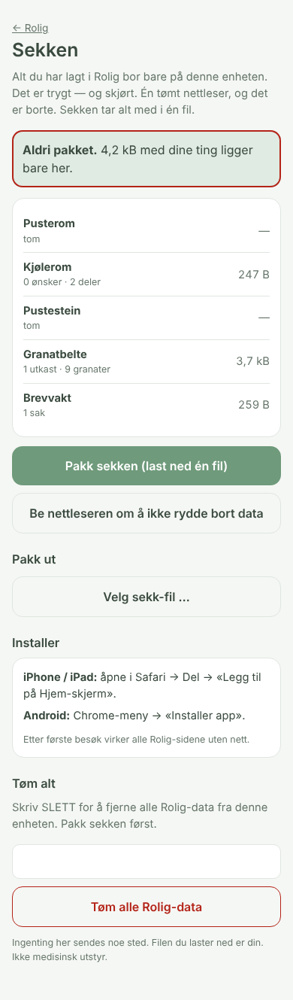

# 05 — Sekken

> Alt du har lagt i Rolig bor bare på denne enheten. Det er trygt — og skjørt.

Rolig som én installerbar, offline app (PWA) — og én fil som tar med alt.

 

## Labben, kort

```
PROBLEM: Fem lokale apper, seks localStorage-nøkler. Én tømt Safari-cache = alt borte.
         HULL.md (1.1) lister fortsatt «PWA/ikon, iOS hjemskjerm» som mangler.
```

| Seed | Utfall |
|------|--------|
| Sky-synk | **Drept.** Regel 1. |
| Eksport i hver app | **Finnes allerede** — men fem filer er fem ting å glemme. |
| **Sekken: PWA + én samlet sekk-fil** | **Overlevde.** |
| Automatisk backup til iCloud/Drive | **Drept.** Sky, tillatelser. |

## Hva

| Fil | Hva |
|-----|-----|
| `manifest.webmanifest` | Navn, ikoner (192/512/maskable), snarveier til Pusterom, Kjølerom, Brevvakt, Sekken |
| `sw.js` | Forhåndslaster alle sju sidene ved første besøk; cache først, nett som reserve; bare samme opphav |
| `rolig-pwa.js` | Registrerer SW fra alle sider — *bare* over http(s). Som fil (`file://`) oppfører alt seg som før |
| `ikoner/` ← `ikon.py` | Tre pustesirkler på salvie, Pusterom-paletten |
| `products/05-sekken/sekken.html` | Oversikt per app, pakk (én JSON), pakk ut per app med angre, be om varig lagring, tøm med «SLETT» |

## Sekk-formatet

```json
{ "format": "rolig-sekk", "v": 1, "created": "2026-10-20T…",
  "keys": { "kjolerom.v1": "<rå JSON-streng>", "granatbelte.v1": "…", "brevvakt.v1": "…", "pustestein.v1": "…", "checkins": "…", "doneActions": "…" } }
```

Verdiene er de rå strengene fra localStorage — ingen tolkning, ingen tap. Utpakking validerer at hver verdi er gyldig JSON og at nøkkelen er kjent; ukjente nøkler ignoreres.

## Bonus: appene snakker sammen

Over http deler sidene opphav. Da leser Granatbelte delene fra Kjølerom, så rå-økter logges med hvem som var framme. Testet.

## Kjør / test

```bash
node products/05-sekken/test/sekken.test.mjs   # 10 tester: starter egen server, installerer SW, går OFFLINE, laster alle sider
```

**Publisering:** Repoet kan serveres som det er fra GitHub Pages (Settings → Pages → branch). Da kan det legges på Hjem-skjerm på iPhone. Jeg har ikke slått det på — det er ditt valg.
