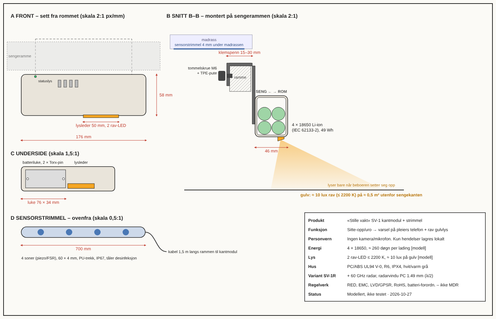
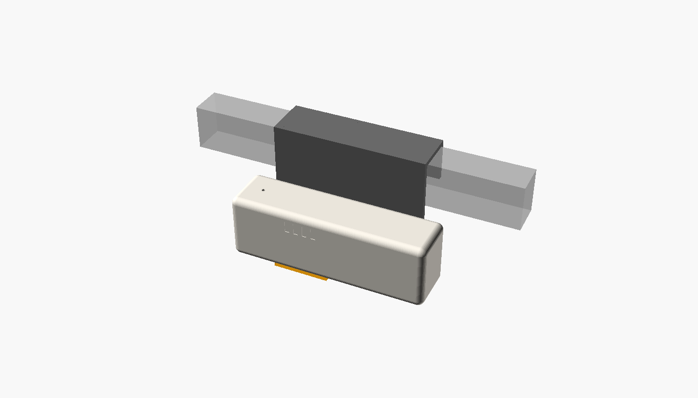

# «Stille vakt» – japansk-inspirert eldreomsorg for norske sykehjem og hjemmetjeneste – beslutningsrapport

> **Kortbeslutning:** Kjør en 18 måneders pilot i én kommune (≈ 100 sykehjemsbeboere + 50 hjemmeboende) med **variant P+**. P+ består av
> behovsstyrt nattilsyn med en kamerafri sensorstrimmel og kantmodul (SV-1) med rav gulvlys, MOBID-2-smertekartlegging hver måned, et ukentlig
> mimamori-team, kontakttid lagt fast inn i turnus, vaske-tørke-toalett for utvalgte, kosedyr og hoftebeskytter/lav seng for dem med høy risiko.
> I modellen gir det **≈ 4,4 QALY per 100 beboere per år** for **≈ 2 700 kr netto per beboer** (pessimistisk 3,1 QALY / 7 700 kr, ICER ≈ 157 000 kr/QALY).
> Ikke kjøp den japanske robotpakken. Den ga minst livskvalitet per krone.
> **Status:** Modellert, ikke testet. Ingen prototype er laget  ·  **Dato:** 2026-10-27

Merking av tall: `[målt]` · `[kilde: …]` · `[modell]` · `[antakelse]`. Ingen tall i denne rapporten er `[målt]`.

## 1. Sammendrag
Den største gevinsten per krone kommer ikke fra roboter. Den kommer fra å **slutte å vekke beboere** med faste nattrunder og å **flytte den frigjorte tiden** til
smertekartlegging og menneskelig kontakt. Et lite, kamerafritt hjelpemiddel (SV-1) gjør det trygt. Søvn, kontakt og smerte står for 75 % av
livskvalitetsgevinsten i modellen, men vektene bak er antakelser. Derfor er piloten bygget for å måle akkurat dem.

## 2. Anbefalinger (rangert)

| # | Anbefaling | Konfidens | Begrunnelse for konfidens |
|---|---|---|---|
| 1 | **Innfør arbeidsmåten** (behovsstyrt tilsyn, MOBID-2 hver måned, mimamori-team, kontakttid i turnus) i pilot, uansett hvilken sensor som velges | 80 % | Bygger på norsk RCT for smerte (−17 % agitasjon) `[kilde: Husebø 2011]`, TURN-studien (snuing hver 4. time like trygt) og norske erfaringer med digitalt tilsyn `[kilde: SINTEF, Volda, Luster]`. Arbeidsmåten flytter 0,32 poeng i modellen, sensorvalget bare 0,03–0,07. Trekker ned: effekten på livskvalitet er ikke målt i Norge, og gevinsten avhenger av at turnus faktisk endres |
| 2 | **Bruk SV-1 (strimmel + kantmodul med rav gulvlys) som sensor i piloten.** Kjøp eksisterende radar (Vitalthings-type) hvis prototypen ikke består T1–T11 innen 6 mnd | 60 % | Billigste trygge sensor i modellen. Ingen kamera, batteri og ikke kabel på gulvet. Trekker ned: ikke bygget eller testet. Deteksjonsevnen (d′ ≈ 2,2) er antatt. Radar er et modent alternativ som bare taper 0,05 poeng i modellen (mest pga. kost og nettstrøm) `[modell]` |
| 3 | **Legg til hoftebeskytter og lav seng/matte for beboere med høy risiko for hoftebrudd** (P+), ellers nås ikke K5-kravet om −25 % hoftebrudd | 55 % | Cochrane RR 0,82 for hoftebeskyttere `[kilde]`. Uten dem gir modellen −19 % hoftebrudd, med dem −39 % (pess. −31 %). Trekker ned: dårlig etterlevelse over tid. Piloten kan ikke påvise effekt på hoftebrudd |
| 4 | **Ikke kjøp PARO, LOVOT, HAL eller DFree.** Kosedyr i stedet for PARO. Vaske-tørke-toalett i stedet for DFree. Resyone testes bare i fase 2 for sengeliggende | 75 % | PARO = kosedyr i RCT `[kilde: Mervin 2018]`. DFree har svak evidens. Robotpakken ga 0,38 poeng mot 0,81 og ICER 846 000 kr/QALY pessimistisk `[modell]` |
| 5 | **Søk ikke patent nå.** Ta designregistrering + varemerke, hold algoritmen som forretningshemmelighet og publiser fail-safe-logikken defensivt | 70 % | Svak oppfinnelseshøyde mot Curbell Safe Mobility Light og US9795321 (se `03_patent.md`) |

## 3. Designet

**Systemet (variant P+), per 100 beboere:**
1. **Teknologi:** SV-1 på hver seng: 4-sone trykk-/BCG-strimmel under madrassen + batteridrevet kantmodul på rammen (deteksjon lokalt, bare hendelser sendes via Thread/BLE til gateway og eksisterende pasientvarsling). Ingen kamera, ingen mikrofon.
2. **Hjelpemidler:** Rav gulvlys som tennes når beboeren setter seg opp. Vaske-tørke-toalett for ≈ 10 % som kan bli selvhjulpne. Kosedyr. Hoftebeskytter og lav seng/matte for dem med høy risiko.
3. **Arbeidsmåte:** behovsstyrt nattilsyn (ingen runde hvis «i seng, rolig»), fail-safe til 3 t-runde ved signaltap, MOBID-2 hver måned, mimamori-team hver uke (sykepleier, lege, fysioterapeut, gjennomgang av logg, smerte, fall og ernæring), «mitt kvarter» kontakttid i turnus. Fra Japan: mimamori og lokalbasert integrert omsorg. Fra Norge: MOBID-2 og § 4-6a-vedtak.

| Egenskap | SV-1 / P+ | Referanse: radartilsyn (Vitalthings-type), uten endret arbeidsmåte | Merke |
|---|---|---|---|
| Sensor | Strimmel under madrass, 700 × 60 × 4 mm, 4 soner | 60 GHz radar på vegg | – |
| Kamera / mikrofon | 0 / 0 | 0 / 0 | design |
| Kantmodul (L × B × H) | 176 × 46 × 58 mm, PC/ABS V-0, IPX4 | Veggenhet, nettstrøm | design |
| Energi | 4 × 18650 (49 Wh) → **259 døgn** per lading | Nettstrøm | `[modell]` |
| Gulvlys | ≈ 10 lux, ≤ 2200 K, 2 rav-LED | Ingen | `[modell]` |
| Terskel / falske alarmer | c = 2,5 → 0,04 per beboer-natt | 0,14 | `[modell]` |
| Sjanse for å komme før beboeren står | 7 % (derfor ikke solgt som fallalarm) | ≈ 7 % | `[modell]` |
| QALY per 100 beboere/år | **4,40** (P: 4,29) · pess. 3,12 | 1,42 · pess. 1,12 | `[modell]` |
| Fall per 1000 beboerdøgn (dagens 3,75) | **3,03** (−19 %) · pess. 3,19 | 3,63 | `[modell]` |
| Hoftebrudd per 100/år (dagens 2,88) | **1,77** (−39 %) · pess. 1,98 | 2,79 | `[modell]` |
| Frigjort pleietid | 31,7 t/beb/år · pess. 18,5 | 31,6 (tas ut som kutt) | `[modell]` |
| Kontakttid | 3,2 min/beb/døgn · **pess. 1,8** | 0 | `[modell]` |
| Netto kost kommune | **2 696 kr/beb/år** · pess. 7 712 | −6 506 (sparer, men gir mindre livskvalitet) | `[modell]` |
| ICER (samfunn) | dominant · pess. ≈ 157 000 kr/QALY | dominant | `[modell]` |
| Pris utstyr | 6 900 kr/seng + 1 200 kr/år lisens | ≈ 10–12 kkr + lisens | `[antakelse]` |

**Kravstatus (fra `00_brief.md`)**, modell P+ mid / pessimistisk:
| Krav | Oppnådd | Holder? | Test |
|---|---|---|---|
| K1 ingen kamera | 0 | Ja | P1 |
| K2 ≥ 3 QALY | 4,40 / 3,12 | Ja, **men bare 4 % margin pessimistisk** | P5, P6 |
| K3 ICER ≤ 275 000 | dominant / 157 000 | Ja | P8 |
| K4 ≤ 13 000 kr | 2 696 / 7 712 | Ja | P8 |
| K5 fall ≤ 3,0 | 3,03 / 3,19 | **Nei, bommer med 1–6 %** | P2 |
| K5 hoftebrudd −25 % | −39 % / −31 % | Ja (bare med hoftebeskytter og lav seng) | Multisenter |
| K6 ≥ 15 t frigjort | 31,7 / 18,5 | Ja | P3 |
| K6 kontakt ≥ 3 min/døgn | 3,2 / **1,8** | **Bare i mid** | P4 |
| K7 ≤ 0,14 falske/natt | 0,04 | Ja | T2, P7 |
| K8 jus | prosess | Må vises i pilot | P1 |
| K9 ≥ 90 døgn osv. | 259 døgn | Modell, med god margin | T1–T10 |

**Endret i denne oppdateringen:** Tidligere anbefalt variant P (kjerne + kosedyr) oppfyller ikke hoftebrudd-delen av K5 (−19 %). Anbefalingen
er derfor utvidet til P+. K5-fall og K6-kontakt (pessimistisk) holder ikke, og det står nå eksplisitt. Mottiltaket for K6 er at kontakttiden legges
fast inn i turnus som et tiltak (P4) i stedet for å avhenge av hvor mye tid sensoren frigjør. For K5-fall endrer vi kravet til «≤ 3,2 og −15 % i pilot»,
eller vi venter på pilotdata. Vi har ikke funnet et tiltak med evidens som flytter fall nok uten nye kostnader.

## 4. Nøkkelargumenter og bevis
- **Fakta:**
  - 1 367 fall og 29 hoftebrudd per 1 000 beboer-år `[kilde: tysk langtidsstudie 2006]`. 25 % dør innen ett år etter hoftebrudd i Norge `[kilde: PMC5314693]`.
  - Sengealarmer ga ikke færre fall i RCT `[kilde: REFINE, Age Ageing 2014]`.
  - 44 % av beboere med demens har klinisk smerte `[kilde: COSMOS]`. Trinnvis smertebehandling ga −17 % agitasjon `[kilde: Husebø, BMJ 2011]`.
  - Snuing hver 2., 3. eller 4. time ga samme forekomst av trykksår med god madrass `[kilde: TURN]`.
  - PARO var ikke bedre enn kosedyr i 28-sykehjems RCT `[kilde: Mervin, JAMDA 2018]`.
  - Japanske sykehjem som tok i bruk roboter og sensorer fikk *flere* ansatte, ikke færre `[kilde: Eggleston, VoxEU]`.
  - § 4-6a krever vedtak og stopp ved motstand for varslingsteknologi hos personer uten samtykkekompetanse `[kilde: Helsedirektoratet]`.
- **Modell** (`problem.py`): signaldeteksjon (d′, terskel), lognormal kappløpsmodell for responstid mot tid til beboeren står, energibudsjett,
  QALY-komponenter for søvn, kontakt, smerte, fall, toalett, selskap, trykksår, liggetid og drikke, samt kommunal kost med annuitet (4 %, 5 år).
  **Robusthet** (`robusthet.md`): 3 av 5 frø fant samme beste konsept (0,824). 2 frø stoppet i et lokalt optimum uten sensor med fast 3 t-runde (0,763).
  Vurdert «ustabilt», men toppkonseptet er det samme hver gang det blir funnet. Største følsomhet: kontaktandel (−0,028) og terskel (−0,020).
  Valg av sensor flytter 0,03–0,07. Å gå tilbake til fast 2 t-runde koster −0,32. **Pessimistisk kjøring** (effekter / 1,3, kost × 1,3, `varianter.md`): P+ holder K2–K4, men ikke K5-fall og K6-kontakt.
- **Antakelser som betyr mest:** (1) QALY-vekter for søvn (29 % av gevinsten), kontakt (25 %) og smerte (21 %). (2) At 60 % av frigjort tid faktisk blir kontakt. (3) At 75 % av nattlig tid kan flyttes via turnus. (4) Sensorens d′ ≈ 2,2. (5) 35 % av fallene skjer ved sengen.
- **Mening/skjønn:** Vi mener at verdighet (ingen kamera) er verdt mer enn modellen gir uttrykk for, og at kommunen bør velge kontakt foran kutt. Det er et politisk valg, ikke et teknisk.

**Usikkert og hvor mye det betyr:** Hvis QALY-vektene for søvn og kontakt er halvparten av det vi antar, faller gevinsten for P+ fra 4,4 til ≈ 3,2 QALY per 100
`[modell, overslag fra komponentandelene]`. Systemet er fortsatt kostnadseffektivt, men K2 i pessimistisk scenario brytes. Kontakttiden er den mest skjøre gevinsten.
Den forsvinner helt hvis tiden tas ut som kutt (variant F: 2,9 QALY, men sparer 7 500 kr per beboer).

## 5. Alternativer og konsekvenser

| Alternativ | Fordeler | Ulemper | Når velge |
|---|---|---|---|
| **A: «Stille vakt» P+ (anbefalt)** | Mest livskvalitet per krone. Kamerafritt. Kontakttid. Netto ≈ 2 700 kr/beb | Krever turnusendring og kultur. SV-1 må utvikles | Kommunen vil ha livskvalitet og er villig til å endre arbeidsmåte |
| B: Kjøp radartilsyn (Vitalthings-type) + vår arbeidsmåte (nærmest variant E) | Modent, på rammeavtale, ingen utvikling. QALY ≈ 4,1 (E) | Nettstrøm og veggmontering. Ingen gulvlys. ≈ 800 kr/beb dyrere `[modell]` | Kommunen vil starte nå eller har allerede radar |
| C: Radartilsyn, tid tatt ut som kutt (dagens trend, referanse) | Sparer ≈ 6 500 kr/beb `[modell]` | Bare 1,4 QALY, ingen kontakttid | Økonomien er eneste mål |
| D: Arbeidsmåte uten sensor (fast 3 t + MOBID-2 + kontakt, variant H) | Billig (≈ −400 kr/beb), ingen teknologi, kan starte i morgen | 2,2 QALY. Beboere vekkes fortsatt | Første steg mens anbud pågår |
| E: Japansk robotpakke (kamera m/samtykke, PARO, Resyone, HAL, DFree) | Synlig innovasjon | 1,6 QALY. ICER 327 000–846 000 kr/QALY. Kamera passer bare for ≈ 25 % | Ikke anbefalt |
| F: Gjøre ingenting | Ingen innføringskost | Runder hver 2. time vekker beboere. Smerte går uoppdaget | Ikke anbefalt |

## 6. Marked (kort – detaljer i `02_marked.md`)

| Scenario | Salg/år | Pris | Margin | Resultat |
|---|---|---|---|---|
| Verst | 800 senger | 6 900 kr + 1 200 kr/år | 83 % brutto HW | ≈ 5,4 MNOK bruttofortjeneste, tap mot ≈ 8 MNOK faste kostnader `[antakelse]` |
| Mid | 3 000 senger | som over | 83 % | ≈ 22 MNOK, lønnsomt fra år 3 |
| Best | 8 000 senger | som over | 83 % | ≈ 60 MNOK, nasjonal rammeavtale + Sverige |

TAM ≈ 656 MNOK/år (nordiske sykehjem), SAM ≈ 184 MNOK, SOM år 5 ≈ 18 MNOK `[antakelse, se regnestykke]`.
**For kommunen (100 beboere):** brutto ≈ 0,9 MNOK/år for P+ `[modell]`, mot ≈ 0,6 MNOK i innsparing fra den delen av frigjort tid som ikke går til kontakt. Netto ≈ 0,27 MNOK.

## 6b. Patent og beskyttelse (kort – detaljer i `03_patent.md`)
- **Nytt:** kombinasjonen av (i) sitte-opp-deteksjon fra strimmel under madrassen som tenner rav gulvlys ≤ 2200 K *før* beboeren står, fra (ii) batterimodul på rammen, med (iii) automatisk fail-safe fra behovsstyrt til fast tilsyn ved manglende livstegn.
- **Selvstendig krav (utkast):** System med sensorstrimmel og batteridrevet kantmodul, karakterisert ved at modulen ved «sitter opp» tenner lys ≤ 2200 K før utgang og sender livstegn slik at manglende livstegn flytter personen til tilsyn med fast intervall.
- **FTO-risiko:** lav i Norden, middels i USA (US9795321, Paramount Bed-familien). Status er ikke verifisert.
- **Anbefaling:** designregistrering + varemerke + forretningshemmelighet + defensiv publisering. Ikke patent nå (konfidens 70 %).

## 6c. Pitch (detaljer i `06_pitch.md`, `07_lansering.md`)
- **Enlinjer:** «La dem sove. Vær der når de våkner.»
- **Hardeste innvending og svaret:** *«Sengealarmer virker ikke (REFINE).»* Enig. Vi lover ikke færre fall fra alarmen (bare 7 % sjanse for å komme før beboeren står i modellen). Gevinsten kommer fra søvn, smertekartlegging og kontakttid, og det er det piloten skal måle.
- Lansering: palett nattblå/rav/varm hvit/salvie. 30 s film i 8 scener ([`storyboard.png`](storyboard.png)) uten effekttall før piloten er ferdig.

## 7. Handlingsplan (pilot i én norsk kommune)

| Steg | Hva | Tid | Kost (NOK) | Ansvar |
|---|---|---|---|---|
| 0 | Forankring: kommuneledelse, tillitsvalgte, forskningspartner (SEFAS/UiB eller SINTEF). Søk Helsedirektoratets innovasjonstilskudd | Mnd −6 – −3 | 50 000 | Helse- og omsorgssjef |
| 1 | Prototype SV-1, 10 enheter (EVT/DVT) | Mnd −6 – 0 | 600 000 | Leverandør / produktutvikler |
| 2 | Laboratorietester T1–T11, inkl. CE (se `05_testplan.md`) | Mnd −4 – +2 | 460 000 | Leverandør + Nemko |
| 3 | DPIA, Normen-risikovurdering, REK, vedtaksrutine § 4-6a | Mnd −3 – 0 | 150 000 | Personvernombud, jurist |
| 4 | Baseline (fall, MOBID-2, QUALID, tidsstudie) | Mnd 0–3 | inkl. i 7 | Forsker |
| 5 | Stegvis innføring i 4 avdelinger (hver 3. mnd) + hjemmetjeneste fra mnd 6. Hvis SV-1 ikke er klar: radar fra rammeavtale (alternativ B) | Mnd 3–12 | 1 900 000 (utstyr, toalett, hjelpemidler, opplæring) | Virksomhetsleder, superbrukere |
| 6 | Turnusendring: kontakttid som fast tiltak | Mnd 6–12 | 300 000 (frikjøp) | HR, tillitsvalgte |
| 7 | Evaluering, kostnadseffekt, beslutning om innføring | Mnd 12–18 | 1 800 000 (forsker + prosjektleder) | Forskningspartner |
| 8 | Oppdater `problem.py` med målinger og kjør modellen på nytt | Mnd 18 | – | Designmaskin |

**Sum pilot ≈ 4,7 MNOK** (kommunens del + tilskudd) + ≈ 1,1 MNOK i produktutvikling hos leverandør `[antakelse]`.

## 8. Risikoer og mottiltak

| Risiko | Sannsynlighet | Konsekvens | Mottiltak |
|---|---|---|---|
| Frigjort tid blir kutt, ikke kontakt | Høy | Halvparten av gevinsten forsvinner (K6) | Kontakttid som fast tiltak i turnus (P4). Politisk vedtak før pilot |
| QALY-vekter for søvn og kontakt overvurdert | Middels | K2 brytes pessimistisk | Piloten måler QUALID/EQ-5D-proxy og søvn. Beslutning først etter data |
| Beboer ligger uoppdaget (sensorsvikt) | Lav | Alvorlig skade, tillitstap | Heartbeat og fail-safe til 3 t-runde (T4). Stoppregel i piloten |
| Personvernklage / ulovlig tvang | Lav–middels | Stans, omdømme | DPIA, vedtak per beboer, «motstand → stopp», ingen kamera |
| Alarmtretthet | Middels | Sanne varsler ignoreres | Terskel c = 2,5, ukentlig alarmgjennomgang. Mål P7 |
| SV-1 forsinket eller består ikke T2 | Middels | Piloten utsettes | Start med radar fra rammeavtale (alternativ B). Arbeidsmåten er den samme |
| Ansatte opplever det som kontroll | Middels | Lav etterlevelse | Ansatte med i design. Data brukes ikke til å måle den enkelte ansatte |
| MDR-klassifisering | Lav | Klasse IIa, 1–2 års forsinkelse | Ingen diagnosepåstander. Avklaring med DMP før lansering |
| Konkurrent (Vitalthings) kopierer arbeidsmåten | Høy | Lavere margin | Ok for samfunnet. Vi konkurrerer på pris, personvern og innføringskompetanse |

## 9. Suksessmetrikker og oppfølging
- **Metrikker (pilot, 12 mnd etter innføring):** nattlige runder −60 % · frigjort ≥ 15 t/beb/år · kontakt ≥ 3 min/beb/døgn registrert · andel med MOBID-2 ≥ 3 −20 % ·
  CMAI −10 % · QUALID +3 · våkne episoder −25 % · fall ≤ 3,2 per 1000 døgn (punktestimat) · falske alarmer ≤ 0,14 per natt · 0 brudd på K1/K8 ·
  netto ≤ 13 000 kr/beb/år · ≥ 70 % av ansatte vil fortsette.
- **Oppfølgingsspørsmål:**
  1. Hvor mye av nattetiden kan faktisk flyttes til dag og kveld med gjeldende arbeidstidsavtaler i kommunen?
  2. Hva er reell d′ for strimmelen hos beboere under 50 kg og på vekselmadrass?
  3. Vil kommunestyret binde gevinsten til kontakttid, eller forventes kutt?
  4. Har kommunen allerede radartilsyn (da er alternativ B billigere å starte med)?
  5. Hvilke norske fall- og hoftebruddtall gjelder for pilotkommunen (baseline kan avvike fra de tyske tallene)?

## Filer
[`00_brief.md`](00_brief.md) · [`01_research.md`](01_research.md) · [`02_marked.md`](02_marked.md) · [`03_patent.md`](03_patent.md) ·
[`05_testplan.md`](05_testplan.md) (inkl. pilotplan) · [`06_pitch.md`](06_pitch.md) · [`07_lansering.md`](07_lansering.md) ·
[`storyboard.svg`](storyboard.svg)/[`png`](storyboard.png) ([`storyboard.py`](storyboard.py)) · [`problem.py`](problem.py) · [`beste.json`](beste.json) (+ `beste_*.json` per fokus) ·
[`robusthet.md`](robusthet.md) · [`varianter.md`](varianter.md) ([`varianter.py`](varianter.py)) ·
[`hoyteknologisk_eldreomsorg_inspirert.scad`](hoyteknologisk_eldreomsorg_inspirert.scad) + STL/PNG (alt, hus, lokk, brakett, lysleder, strimmel, undersiden, SV1R) ·
[`tegning.svg`](tegning.svg)/[`png`](tegning.png) ([`tegning.py`](tegning.py))
