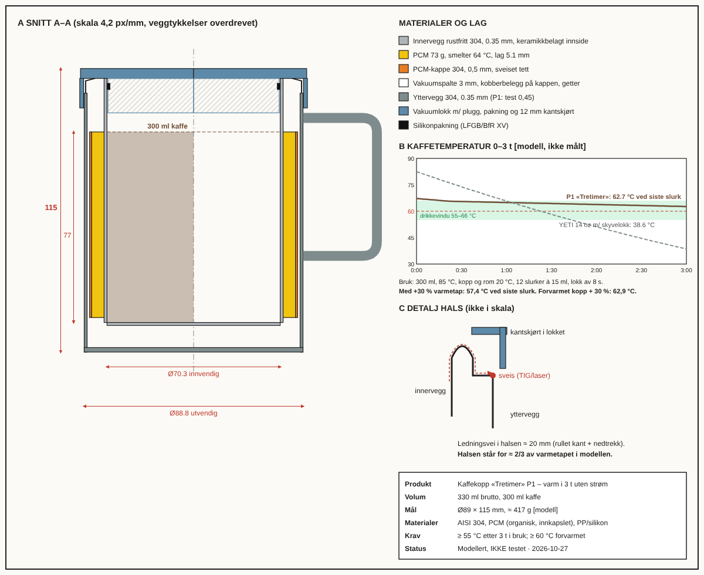
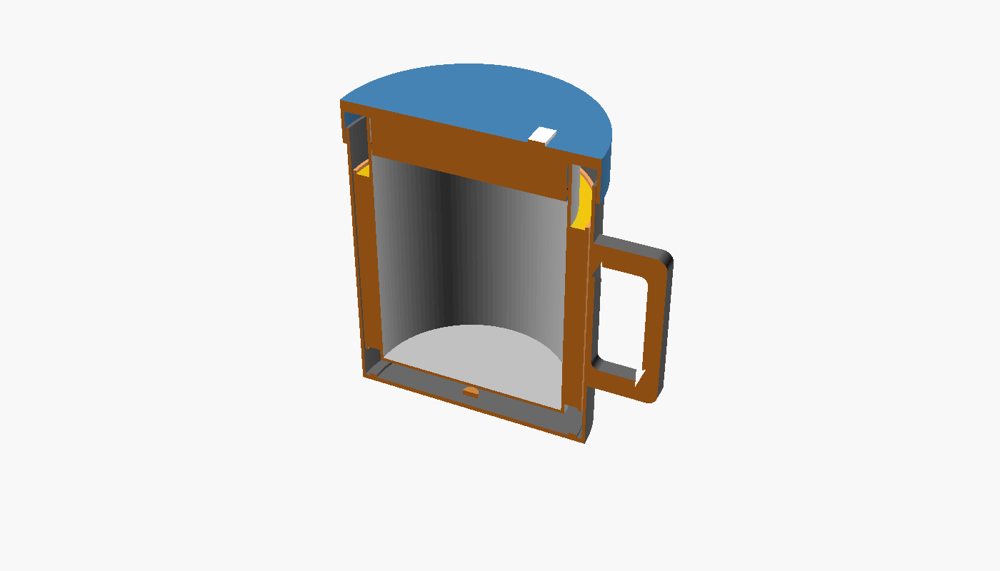

# Kaffekopp «Tretimer» – beslutningsrapport

> **Kortbeslutning:** **Bygg P1 som plattform:** én vakuumkropp med lang hals og vakuumlokk med kantskjørt, i to varianter: **A med PCM** (premium) og **B uten PCM** (reserve). Test begge før verktøybestilling.
> Modellen gir A **62,7 °C ved siste slurk etter 3 t** mot 38,6 °C for en YETI-kopp med skyvelokk. Med 30 % høyere varmetap enn antatt blir det bare **57,4 °C**. Markedsløftet blir derfor **≥ 55 °C, og ≥ 60 °C når koppen er forvarmet**, til test viser mer.
> **Status:** Modellert, ikke testet  ·  **Dato:** 2026-10-27

Merking av tall: `[målt]` · `[kilde: …]` · `[modell]` · `[antakelse]`. Ingen tall i denne rapporten er `[målt]`.

## 1. Sammendrag
En kopp med hank kan holde 300 ml kaffe varm i 3 timer uten strøm, men **bare med tett vakuumlokk og en
hals som leder lite varme**. Uten lokk eller med vanlig skyvelokk er det fysisk umulig. PCM (faseendringsmateriale
som smelter ved 64 °C) gjør kaffen drikkeklar på ≈ 17 min i stedet for ≈ 2,5 t, men gir bare ≈ 2 °C mer ved 3 t.
Kravet på 60 °C ved siste slurk har for liten margin til å loves før test. 55 °C (og 60 °C forvarmet) holder i alle scenarier.

## 2. Anbefalinger (rangert)

| # | Anbefaling | Konfidens | Begrunnelse for konfidens |
|---|---|---|---|
| 1 | **Bestill prøveserie av P1-A (med PCM) og P1-B (uten PCM, samme kropp) hos 2–3 OEM-er for vakuumbeger, og kjør testplanen (T1–T5) før noe verktøy kjøpes** | **80 %** | Fysikken er etablert (vakuum, stråling, fordamping) og robust i retning: alle scenarier slår referansen med ≥ 20 °C `[modell]`. Det som trekker ned: halsens varmetap (67 % av totalen) bygger på en antatt effektiv lengde |
| 2 | **Lov «≥ 55 °C etter 3 t» (≥ 60 °C forvarmet), ikke «60 °C» generelt**, før T1 er bestått | **85 %** | Holder ned til +40 % varmetap `[modell]`. Kalibreringssjekk mot Stanley tyder på at modellen heller er pessimistisk enn optimistisk |
| 3 | **Lanser A (PCM) som hovedprodukt til 599 NOK** hvis T1 og T11 (PCM-kappe tett) består. Ellers B til 449–499 NOK | **60 %** | A har den tydeligste historien («drikkeklar nå, varm om 3 t, uten batteri»). Men PCM gir mer vekt (+150 g), mer kost (+36 kr) og lekkasjerisiko. Betalingsviljen er ikke testet (T13 + forhåndssalg) |
| 4 | **Bestill FTO-analyse hos patentrådgiver** (Thero US11350778B2 har falt bort og har ingen EP-familie; Booska-familien er aktiv) | 90 % (at det trengs) | Billig forsikring (≈ 20–40 kNOK) mot et kjent nærliggende patentområde |

## 3. Designet

Konsept: **trippelvegg i rustfritt stål**. Innervegg (keramisk belagt), deretter en sveiset PCM-kappe med 73 g
organisk PCM (64 °C), så 3 mm vakuum med kobberbelegg og getter, og ytterst ytterveggen. Drikkekanten er
**rullet** slik at ledningsveien mellom indre og ytre vegg blir ≈ 20 mm. **Vakuumlokket** har en plugg ned
i halsen, silikonpakning, en drikkeåpning med skyver og et **12 mm kantskjørt** som isolerer sveisesonen.

| Egenskap | P1-A «Tretimer» | P1-B (uten PCM) | Referanse YETI Rambler 14 oz m/ MagSlider | Merke |
|---|---|---|---|---|
| Siste slurk etter 3 t, bruk (K1) | **62,7 °C** | 60,9 °C | 38,6 °C | `[modell]` |
| – med varmetap +30 % | **57,4 °C** | 56,2 °C | 33,2 °C | `[modell]` |
| – forvarmet, varmetap +30 % (K1b) | **62,9 °C** | – | 33,5 °C | `[modell]` |
| Lukket 3 t (K2) | 63,0 °C | 67,7 °C | 47,2 °C | `[modell]` |
| Temperatur rett etter helling (85 °C inn) | 67,2 °C | 83,4 °C | 82,5 °C | `[modell]` |
| Tid til drikkeklar ≤ 66 °C (K3) | **17 min** | 146 min | 60 min | `[modell]` |
| Andel av 3 t i drikkevindu 55–66 °C | **91 %** | 19 % (for varm de første 2,5 t) | 24 % | `[modell]` |
| Volum brutto / kaffe | 330 / 300 ml | 330 / 300 ml | 414 ml | `[modell]` / `[kilde]` |
| Ytre mål Ø × H (K5) | 89 × 115 mm | 89 × 115 mm | ≈ 88 × 98 mm | `[modell]` |
| Vekt (K6) | 417 g | 266 g | ≈ 300 g (modell) | `[modell]` |
| Indre Ø / plate / halslengde | 70,3 / 0,35 / 20 mm | samme | 80 / 0,5 / 6 mm | `[modell]` / `[antakelse]` for ref |
| PCM | 73 g, smelter 64 °C | – | – | `[modell]` |
| Produksjonskost landet (K12) | 141 NOK | 105 NOK | – | `[modell/antakelse]` |
| Veil. pris | 599 NOK | 449–499 NOK | ≈ 350–450 NOK | `[antakelse]` / `[kilde]` |

Fordeling av varmetapet i A ved 64 °C: **hals 67 %**, lokk 14 %, stråling 13 %, restgass 6 % (totalt 1,6 W) `[modell]`.

## 4. Nøkkelargumenter og bevis
- **Fakta:**
  - Folk foretrekker i snitt ≈ 60 °C kaffe (spenn 37–88 °C). Aksepten er best ved 58–66 °C `[kilde: Lee & O'Mahony 2002; PMC9712614]`.
  - Drikke > 65 °C er klassifisert som sannsynlig kreftfremkallende (2A) `[kilde: IARC 2016]`.
  - Ember holder bare ≈ 80 min på batteri `[kilde: Walmart/Slickdeals 2026]`.
  - PCM-innsats (Joulies) hjalp lite i åpen kopp, men holdt 60 °C i 2 t i en reisekopp `[kilde: Cook's Country]`. PCM virker altså bare når tapet allerede er lavt, slik modellen også viser.
  - Konseptet vakuum + PCM er kjent fra Temperfect (2013) og Thero-patentet (2019) `[kilde]`.
- **Modell** (`problem.py`): Tidssimulering med 60 s steg av stråling over vakuum, ledning i halsen (fin-modell), lokk-U-verdi, fordamping fra åpen flate (Lewis-analogi) og PCM-entalpi.
  - **Robusthet:** 5 frø gir ett konsept, poeng 0,751–0,753, altså stabilt.
  - **Følsomhet:** Mest følsom for diameter. Designet ligger inntil høydegrensen på 125 mm, og ved smalere kopp blir den for høy.
  - **Kritiske valg:** vakuumlokk (−0,18 i poeng ved klikklokk), kantskjørt (−0,12), kobber (−0,07).
  - **Kalibrering:** Modellen gir Stanley 350 ml 3,6–4 t til 60 °C, mot oppgitt «5 t varm». Modellen er altså ikke for optimistisk.
- **Antakelser som betyr mest:** (1) Effektiv ledningslengde i halsen og varmeovergang på yttervegg. Halsen er 67 % av tapet, så ±30 % her gir ±4–5 °C ved 3 t. (2) Kaffen helles på 85 °C. Ved 80 °C smelter ikke PCM-et helt og resultatet blir 57,0 °C. (3) Latent varme 170 kJ/kg. (4) OEM-kost 141 NOK, som ikke er tilbudt.
- **Mening/skjønn:** At premiumkjøpere betaler 599 NOK for «drikkeklar nå» er en hypotese, ikke data. At PCM-historien selger bedre enn «bare et bedre lokk», er også skjønn.

## 5. Alternativer og konsekvenser

| Alternativ | Fordeler | Ulemper | Når velge |
|---|---|---|---|
| **A (anbefalt): vakuum + PCM + vakuumlokk m/ skjørt** | Drikkeklar på 17 min, i drikkevinduet 91 % av tiden, 62,7 °C ved 3 t `[modell]`. Unik historie uten batteri | 417 g. Kost 141 kr. Risiko for lekkasje i PCM-kappen. Krever tredje sveis | T1, T5 og T11 består, og forhåndssalg ≥ 300 stk |
| **B: samme kropp og lokk, uten PCM** | 266 g, kost 105 kr, enklere og mer robust. 60,9 °C ved 3 t `[modell]` | Skåldende/for varm i ≈ 2,5 t (83 °C ved helling). Svakere differensiering mot Fellow/Stanley | PCM-kappen lekker eller blir for dyr. Eller kundene vil ha 70 °C+ |
| C: smal reisekopp (Ø60, høy) | Lavest tap, enklest å nå 60 °C | Ikke en kopp. Kan ikke drikkes fra kanten. Konkurrerer med Stanley/Thermos til 300 kr | Segment B (utendørs) viser mest interesse |
| D: ikke gjøre noe / kjøp YETI eller Ember | Ingen investering | YETI: ≈ 39 °C ved 3 t `[modell]`. Ember: lading, ≈ 1 000+ NOK | T1 feiler, eller forhåndssalg < 100 stk |

## 6. Marked (kort – detaljer i `02_marked.md`)
TAM Norden + EU ≈ 5 mrd NOK/år · SAM (premium bordkopp, Norden + DE + NL) ≈ 260 MNOK/år · SOM år 2–3 ≈ 2,6 MNOK `[antakelse]`.

| Scenario | Salg/år | Pris | Margin (DB/stk) | Resultat/år |
|---|---|---|---|---|
| Verst | 1 500 | 499 NOK | ≈ 51 NOK | −224 kNOK |
| Mid | 5 000 | 599 NOK | ≈ 133 NOK | +315 kNOK (tilbakebetalt ≈ 3,2 år) |
| Best | 15 000 | 649 NOK | ≈ 183 NOK | +2,15 MNOK (tilbakebetalt ≈ 0,5 år) |

## 7. Handlingsplan

| Steg | Hva | Tid | Kost (NOK) | Ansvar |
|---|---|---|---|---|
| 0 | FTO/nyhetssøk hos patentrådgiver. RFQ til 3 OEM (A og B) | Uke 1–4 | 30 000 | Eier + patentrådgiver |
| 1 | Prototype: OEM-prøveserie 6× A, 3× B (+ 3 YETI-referanse). 3D-print formmodell av STL for ergonomi | Uke 3–10 | 60 000–100 000 | OEM / produktutvikler |
| 2 | Test T1–T6, T9, T12 (varme, PCM, mål, søl, berøring) → `05_testplan.md` | Uke 10–13 | 30 000 | Testansvarlig (lab: SINTEF/universitet for DSC) |
| 3 | Kalibrer modellen (hals, lokk, PCM), kjør maskinen på nytt, lag P2 og bestem løfte og variant (A eller B) | Uke 13–15 | 10 000 | Ingeniør |
| 4 | Langtidstester T7, T8, T10, T11 (oppvask, fall, matkontakt, PCM-sykling) parallelt med P2 | Uke 13–20 | 85 000 | Ekstern lab |
| 5 | Pilot/forsalg: Kickstarter eller egen nettside med 12 brukere (T13) og video av måling. Mål ≥ 300 forhåndssalg | Uke 16–24 | 50 000 (innhold, annonser) | Marked |
| 6 | Verktøy og produksjonsordre (≥ 2 000 stk) bare hvis stegene 2–5 består | Uke 24+ | ≈ 600 000–800 000 | Eier |

## 8. Risikoer og mottiltak

| Risiko | Sannsynlighet | Konsekvens | Mottiltak |
|---|---|---|---|
| Halsen leder mer varme enn modellert, og K1 feiler | Middels (30 %) | Løftet må ned til ≈ 52–55 °C | T4 tidlig. Lengre hals (rammen tillater > 20 mm), tynnere plate i halsen, plast-/silikonring over kanten |
| PCM-kappen lekker over tid | Lav–middels (15 %) | Tilbakekalling, mulig PCM i drikken | Sveiset kappe + heliumtest 100 %, matvaregodkjent parafin, T11. Ha B som reserve |
| OEM-kost > 170 NOK for A | Middels (35 %) | Mid-scenariet går i null | 3 tilbud. B som billigere variant. Pris 649 |
| Kunder synes 64 °C er for kaldt | Middels (25 %) | Dårlige omtaler | Smeltepunkt er en fri parameter (56–68 °C). Test 62/64/66 i T13 |
| Vakuumtap ved fall | Lav (10 %) | Kald kopp, reklamasjon | Yttervegg 0,45 mm i P2, fotring i silikon, T8 |
| Patentkrav (Booska-familien eller ukjente EP/CN) | Lav (10 %) | Redesign eller lisens | FTO før verktøy |
| Påstand kan ikke dokumenteres (GPSR/markedsføringsloven) | Lav hvis testet | Bot eller pålegg om endring | Definert testscenario i all markedsføring, rapport fra uavhengig lab |
| Ember eller YETI lanserer noe lignende | Middels | Prispress | Raskt til marked via forhåndssalg. Bygg merkevare rundt «uten batteri» |

## 9. Suksessmetrikker og oppfølging
- **Metrikker:**
  - T1: alle 18 målinger ≥ 55 °C, snitt ≥ 58 °C. T1b: ≥ 60 °C.
  - T3: drikkeklar ≤ 20 min.
  - OEM-kost ≤ 150 NOK.
  - ≥ 300 forhåndssalg på 30 dager.
  - Reklamasjon < 2 % første år. Snittvurdering ≥ 4,4/5.
- **Hva er usikkert og hvor mye betyr det:**
  - Halsens varmetap (±30 %) gir ±4–5 °C ved 3 t. Det avgjør om vi kan si 60 °C eller bare 55 °C.
  - Kaffetemperaturen ved helling (80 vs. 85 °C) gir ≈ 6 °C ved 3 t.
  - OEM-kost ±30 NOK gir ±150 kNOK/år i resultat.
- **Oppfølgingsspørsmål:**
  1. Hva er den faktiske temperaturen på kaffen når målgruppen heller den i koppen (kanne, maskin, presskanne)?
  2. Foretrekker kundene 60, 64 eller 68 °C? Det bestemmer smeltepunktet.
  3. Vil målgruppen forvarme koppen hvis det står på lokket («skyll varm → 60 °C i 3 t»)?
  4. Er 417 g akseptabelt, eller må vi under 350 g (mindre PCM, tynnere plate)?
  5. Skal koppen tåle bilens koppholder? Det krever Ø ≤ 75 mm nederst.

## Filer
[`00_brief.md`](00_brief.md) · [`01_research.md`](01_research.md) · [`02_marked.md`](02_marked.md) ·
[`problem.py`](problem.py) · [`beste.json`](beste.json) · [`robusthet.md`](robusthet.md) ·
[`kaffekopp_holder_kaffen_varm_3_timer.scad`](kaffekopp_holder_kaffen_varm_3_timer.scad) +
STL/PNG: [samlet snitt](kaffekopp_holder_kaffen_varm_3_timer.stl) ([png](kaffekopp_holder_kaffen_varm_3_timer.png)),
[innerbeholder](kaffekopp_holder_kaffen_varm_3_timer_innerbeholder.stl) ([png](kaffekopp_holder_kaffen_varm_3_timer_innerbeholder.png)),
[ytterbeholder](kaffekopp_holder_kaffen_varm_3_timer_ytterbeholder.stl) ([png](kaffekopp_holder_kaffen_varm_3_timer_ytterbeholder.png)),
[lokk](kaffekopp_holder_kaffen_varm_3_timer_lokk.stl) ([png](kaffekopp_holder_kaffen_varm_3_timer_lokk.png)),
[hank](kaffekopp_holder_kaffen_varm_3_timer_hank.stl) ([png](kaffekopp_holder_kaffen_varm_3_timer_hank.png)) ·
[`tegning.py`](tegning.py) → [`tegning.svg`](tegning.svg) / [`tegning.png`](tegning.png) · [`05_testplan.md`](05_testplan.md)

*STL-ene har vegger på minst 1,2 mm (`PRINT = true`) og er form-/ergonomiprototyper, ikke termiske prototyper.
Den termiske prototypen må lages av OEM i stål med vakuum.*
