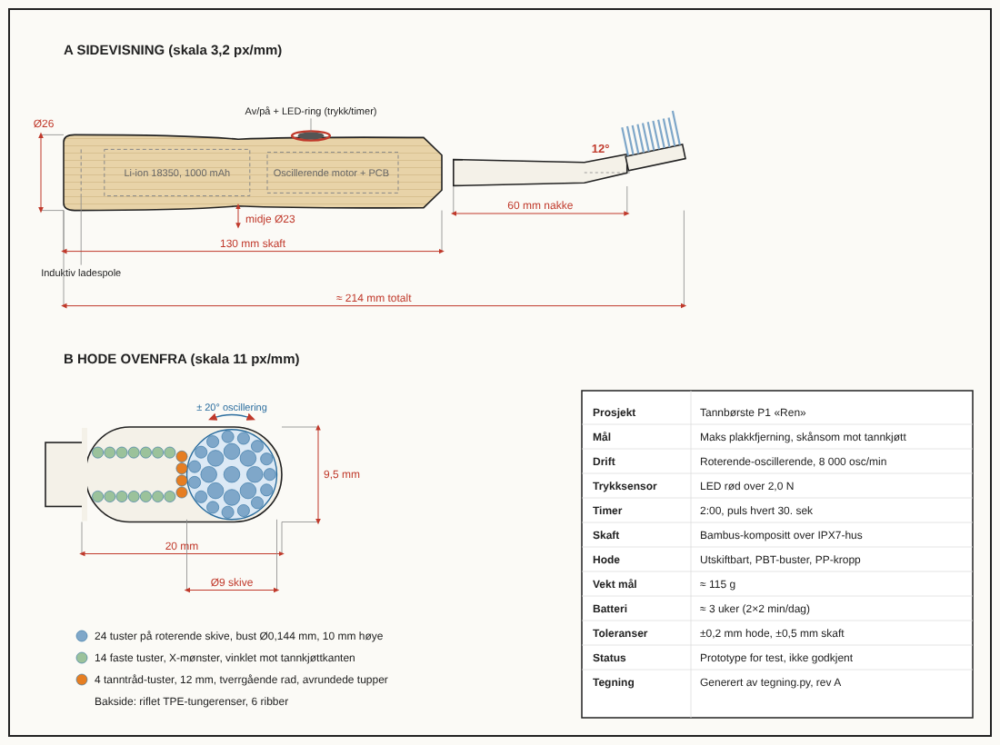

# Tannbørste P1 «Ren»

| Fil | Hva |
|---|---|
| `problem.py` | Parametre og poeng for maskinen |
| `SPESIFIKASJON.md` | Mål, buster, motor, materialer og testplan |
| `prototype.scad` | Parametrisk 3D-modell. Åpnes i [OpenSCAD](https://openscad.org) |
| `p1_hode.stl`, `p1_skaft.stl` | Ferdige filer for 3D-print |
| `tegning.py` → `prototype_tegning.svg/.png` | Teknisk tegning med mål |
| `prototype_3d.png`, `hode_3d.png` | Bilder fra 3D-modellen |

Generer på nytt:

```bash
python3 tegning.py
openscad -D 'DEL="hode"'  -o p1_hode.stl  prototype.scad
openscad -D 'DEL="skaft"' -o p1_skaft.stl prototype.scad
```


